# Лабораторная работа №10
## Кеширование данных

### Цель работы

Изучить принципы кеширования данных в веб-приложениях, подключить Redis в качестве системы кеширования, реализовать кеширование данных приложения и оценить влияние кеширования на производительность.

---

## Краткое описание выполненного задания

К системе из лабораторной работы №9 («Система управления задачами команды»: клиент, PHP-сервер, PostgreSQL, авторизация) подключён Redis. Реализован класс `Cache` с методом `remember`: он проверяет кеш, при промахе берёт данные из базы, сохраняет их в Redis с временем жизни (TTL) и возвращает пользователю. Кеш подключён для четырёх видов данных: список проектов (справочник), карточка задачи, список задач с фильтрами и поиском, отчёт по проектам. При любом изменении данных устаревшие копии удаляются. Если Redis недоступен, приложение продолжает работать без кеша.

Производительность измерена на 500 007 задачах: без кеша и с кешем, по пяти сценариям плюс два дополнительных. Поиск по названию и сортировка по названию ускорились (×43,5 и ×34,3), отчёт по проектам — ×16,5, а карточка задачи по номеру не выиграла вовсе: 5,6 мс без кеша и 6,1 мс с кешем. Автотесты API (83 проверки, из них 22 про кеш) проходят.

## Предметная область

Демонстрационный вариант 0: «Система управления задачами команды» (в вашей работе здесь заполненная карточка вашей предметной области и 2–3 предложения о переносе: что изменили и как проверили).

| Что определить | Значение |
|----------------|----------|
| Приложение | система из лабораторной работы №9: клиент, REST API на PHP, PostgreSQL, вход по токену |
| Система кеширования | Redis 7, клиент для PHP — расширение phpredis |
| Большая таблица для измерений | `tasks`: 500 007 строк (`sql/bigdata.sql`) |
| Что кешируем | список проектов, карточка задачи, список задач с параметрами, отчёт по проектам |

---

**Запуск:**

```bash
cd lab10/src
docker compose up -d                                     # PostgreSQL 16 и Redis 7
php bin/reset-db.php                                     # таблицы, данные, очистка кеша
php bin/redis-check.php                                  # Redis отвечает: PONG
PHP_CLI_SERVER_WORKERS=4 php -S localhost:8000 -t public # сервер на 4 процессах
```

Клиент: `http://localhost:8000/client/` (вход `anna@example.com`, пароль `123456`). Автотесты: `php tests/api-tests.php`. Большие данные для измерений: `php bin/load-bigdata.php`, измерения: `php bin/benchmark.php`. Если порты 5432 или 6379 заняты, используйте `DB_PORT=5433 REDIS_PORT=6380 docker compose up -d` и передайте те же переменные приложению.

---

## Описание реализованного механизма кеширования

### Алгоритм

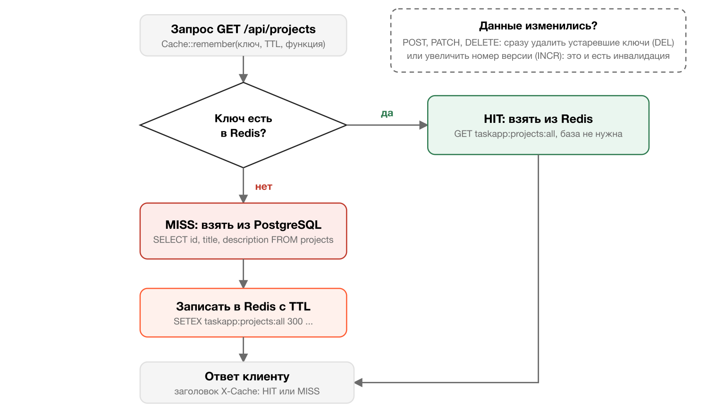

Используется схема **cache-aside**: приложение само управляет кешем. Метод `Cache::remember($ключ, $ttl, $функция)`:

1. проверяет, есть ли в Redis запись с ключом (`GET`);
2. если есть (попадание, **HIT**) — возвращает её, база не нужна;
3. если нет (промах, **MISS**) — вызывает функцию, которая берёт данные из PostgreSQL;
4. сохраняет результат в Redis с временем жизни (`SETEX`) и возвращает его.

Результат виден в заголовке ответа `X-Cache`: `HIT`, `MISS` или `BYPASS` (кеша нет: Redis недоступен или кеш выключен). Значения хранятся как строки JSON; ко всем ключам автоматически добавляется префикс `taskapp:`.

```php
public static function remember(string $key, int $ttl, callable $load): mixed
{
    if (self::redis() === null) { self::mark('BYPASS'); return $load(); }   // кеша нет: идём в базу
    $cached = self::get($key);                       // 1. проверить кеш
    if ($cached !== null) { self::mark('HIT'); return $cached; }
    $value = $load();                                // 2. промах: получить из базы
    if ($value !== null) { self::set($key, $value, $ttl); }   // 3. сохранить в Redis с TTL
    self::mark('MISS');
    return $value;                                   // 4. вернуть
}
```

### Какие данные кешируются

Решение принято по четырём вопросам: как часто читают, как часто меняют, сколько стоит получить из базы, допустимо ли «чуть устаревшее». Подробное обоснование — в [docs/caching.md](./docs/caching.md).

| Данные | Ключ в Redis | TTL | Инвалидация |
|--------|--------------|-----|-------------|
| список проектов | `projects:all` | 300 с | при создании, изменении, удалении проекта |
| карточка задачи | `tasks:item:{id}` | 60 с | при изменении и удалении этой задачи |
| список задач | `tasks:list:v{версия}:{md5 параметров}` | 60 с | при любом изменении задач растёт номер версии `tasks:version`: старые ключи перестают использоваться |
| отчёт по проектам | `report:summary` | 120 с | при изменении задач и проектов |

### Как это встроено в приложение

| Файл | Роль |
|------|------|
| `app/Core/Cache.php` | подключение к Redis (`redis`), чтение и запись (`get`, `set`), алгоритм (`remember`), удаление (`forget`), версии (`version`, `bump`), очистка кеша приложения (`flushApp`) |
| `app/Models/CachedTaskRepository.php` | наследует `TaskRepository`; кеширует `find` и `list`, при `add`, `update`, `delete` выполняет инвалидацию |
| `app/Models/CachedProjectRepository.php` | наследует `ProjectRepository`; кеширует `all`, инвалидация при изменениях |
| `app/Controllers/Api/ReportApiController.php` | отчёт `GET /api/reports/summary` через `Cache::remember` |
| `app/Controllers/Api/*ApiController.php` | единственное изменение: контроллер создаёт кеширующий репозиторий вместо обычного |

Контроллеры и клиент не знают о кеше. Если Redis недоступен, `Cache::redis()` возвращает `null` (подключение с таймаутом 0,5 с, любые ошибки Redis перехватываются), и приложение работает как в лабораторной работе №9. Для измерений есть режим обхода кеша для одного запроса: заголовок `X-Cache-Mode: off` (работает только при `debug = true`).

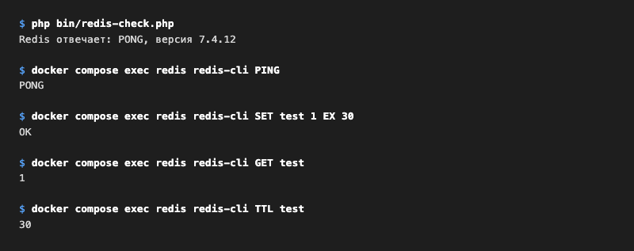

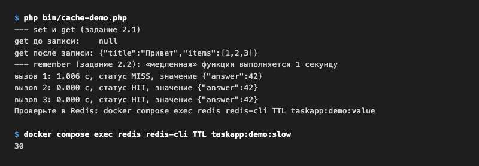

---

## Примеры использования Redis

#### Первый запрос — MISS, повторный — HIT

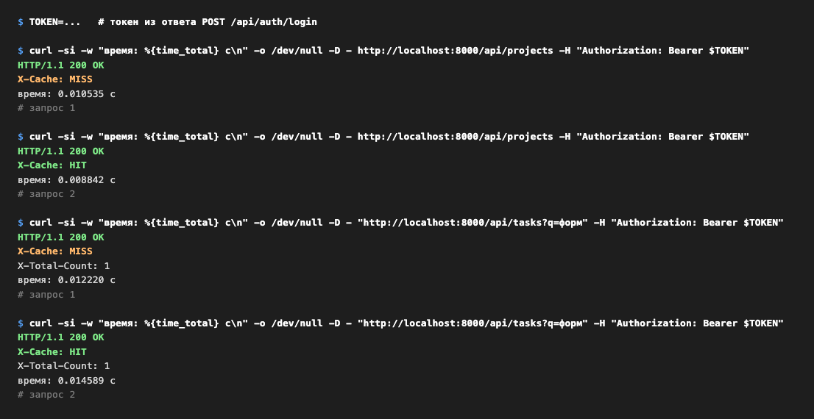

#### Что лежит в Redis: ключи, время жизни, значение

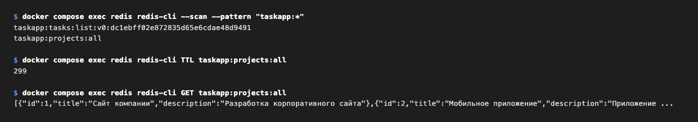

#### Инвалидация: изменили задачу — кеш обновился

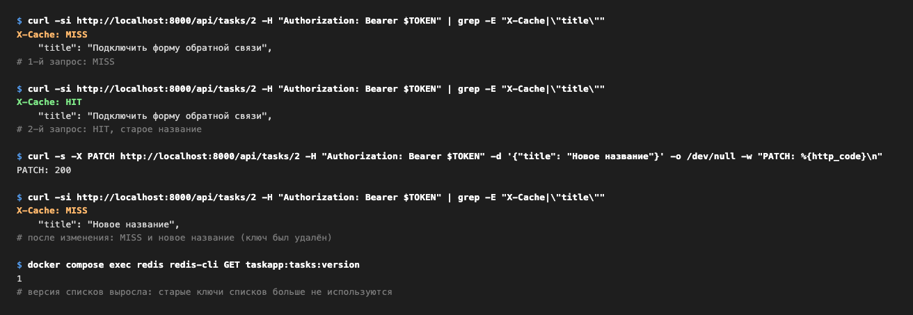

#### Redis недоступен — приложение работает

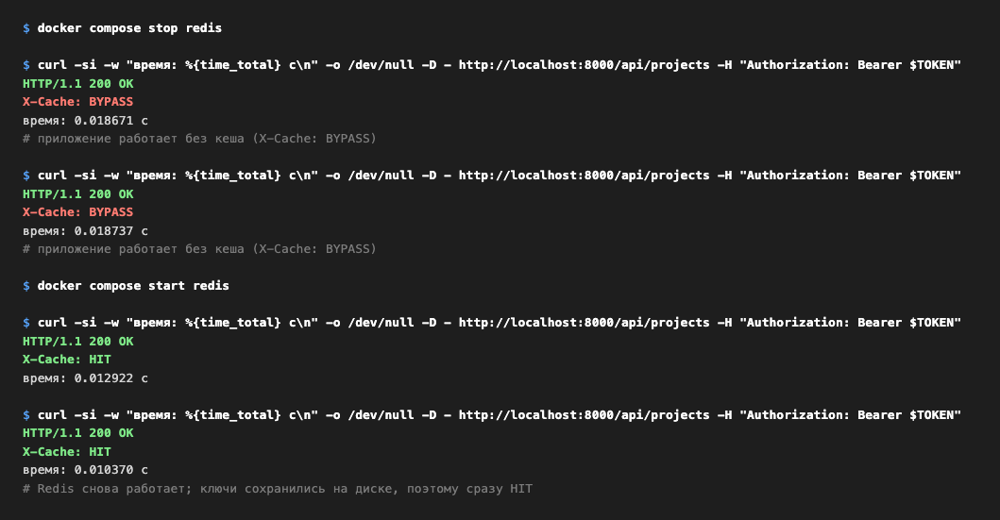

---

## Результаты сравнения производительности

**Условия:** Apple M3 (8 ядер, 16 ГБ), macOS 15.6; PHP 8.2.33 (встроенный сервер `php -S` на 4 процессах, `PHP_CLI_SERVER_WORKERS=4`), расширение phpredis 6.3.0; PostgreSQL 16 и Redis 7.4 в Docker на том же компьютере; клиент измерений `bin/benchmark.php` на том же компьютере. Данные: 500 007 задач и 52 проекта. На каждый сценарий — 60 запросов подряд без кеша (с заголовком `X-Cache-Mode: off`), затем кеш очищался и снова 60 запросов (первый — «холодный», MISS; остальные — HIT), затем нагрузка в течение 3 секунд по 8 запросов одновременно отдельно без кеша и с тёплым кешем (считается, сколько запросов в секунду успел обработать сервер). Перед измерением выполняется прогрев из 3 запросов, которые не учитываются. Время — среднее по запросам (в скобках p95), в миллисекундах. Подробная методика и анализ — в [docs/benchmark.md](./docs/benchmark.md).

| Сценарий | Без кеша, среднее (p95), мс | С кешем: первый запрос, мс | С кешем, среднее (p95), мс | Ускорение | Запросов/с без кеша | Запросов/с с кешем |
|----------|----------------------------|----------------------------|----------------------------|----------:|--------------------:|-------------------:|
| Список проектов | 8,4 (14) | 8,5 | 7,9 (10) | ×1,1 | 461 | 461 |
| Карточка задачи | 5,6 (6,0) | 7,8 | 6,1 (6,3) | ×0,9 | 413 | 329 |
| Список задач (последние 100) | 20 (34) | 23 | 7,2 (10) | ×2,8 | 88 | 269 |
| Поиск по названию | 312 (524) | 254 | 7,2 (10) | ×43,5 | 4 | 418 |
| Отчёт по проектам | 115 (122) | 112 | 7,0 (9,4) | ×16,5 | 16 | 446 |
| Задачи проекта 7, в работе | 14 (17) | 15 | 6,7 (7,3) | ×2,1 | 176 | 407 |
| Задачи, сортировка по названию | 252 (366) | 277 | 7,4 (9,7) | ×34,3 | 4 | 376 |

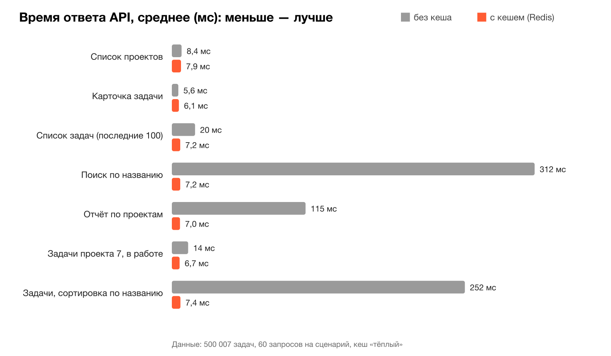

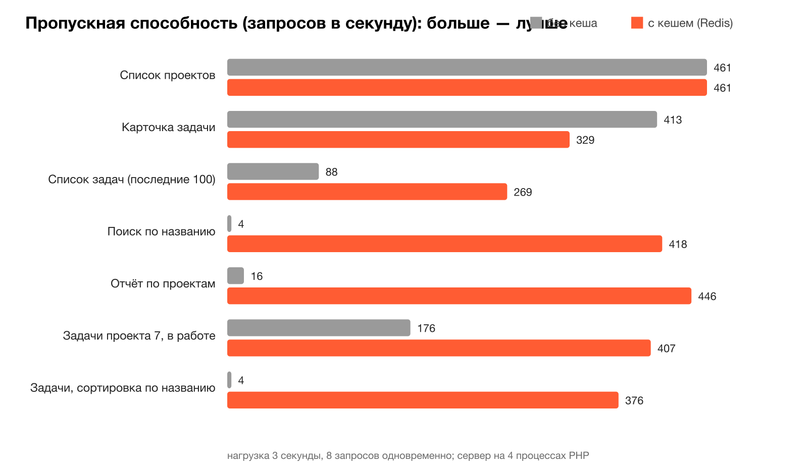

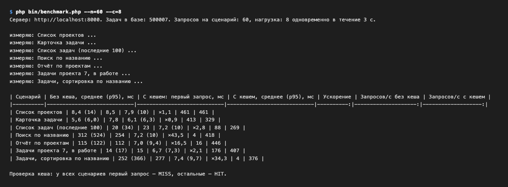

### Анализ

- **Больше всего выиграли «тяжёлые» запросы:** «Поиск по названию» ускорился ×43,5 (312 → 7,2 мс), сортировка по названию — ×34,3 (252 → 7,4 мс), отчёт — ×16,5 (115 → 7,0 мс). Эти запросы просматривают сотни тысяч строк: поиск `ILIKE '%…%'` и сортировка по названию читают всю таблицу, отчёт группирует все задачи. Пропускная способность выросла с единиц и десятков до сотен запросов в секунду.
- **Почти не выиграли «лёгкие» запросы:** карточка задачи по номеру (×0,9) и список проектов (×1,1). Чтение одной строки по первичному ключу PostgreSQL выполняет за доли миллисекунды: Redis отвечает так же быстро, а за обращение к нему тоже приходится платить. Кеш не нужен там, где база и так мгновенна.
- **«Пол» времени ответа — около 7,2 мс:** столько занимают запуск PHP, проверка токена (два запроса к базе) и формирование ответа. Кеш ускоряет только то, что кеширует: даже при HIT быстрее этого «пола» ответ не станет. Поэтому у тяжёлых запросов время с кешем почти одинаково (7,2 мс), каким бы долгим ни был запрос в базе.
- **Холодный запрос не быстрее обычного:** первый запрос с кешем (MISS) занимает столько же, сколько запрос без кеша (например, отчёт: 115 мс без кеша и 112 мс на промахе): он и в базу ходит, и ещё записывает в Redis. Выигрыш начинается со второго запроса.
- **Цена свежести:** выигрыш зависит от доли попаданий. Если данные меняются каждую секунду, ключи постоянно инвалидируются и большая часть запросов становится промахами: тогда кеш дает мало, а при слишком коротких TTL и инвалидациях может даже мешать.
- **Где кеш эффективнее всего:** дорогие запросы (поиск по подстроке, агрегаты, сортировка больших таблиц), которые часто повторяются и допускают «чуть устаревшие» данные: отчёты, справочники, популярные списки.

## Тестирование

Автотесты API (`php tests/api-tests.php`): **83 проверки, все проходят**. Первые 61 — регрессионные проверки лабораторной работы №9 (вход, права, CRUD): они же ловят «залипание» данных в кеше. Разделы 8–9 (22 проверки) относятся к кешу: MISS/HIT, TTL, инвалидация после `PATCH`, `POST`, `DELETE`, ключи для разных параметров, обход кеша, срок жизни.

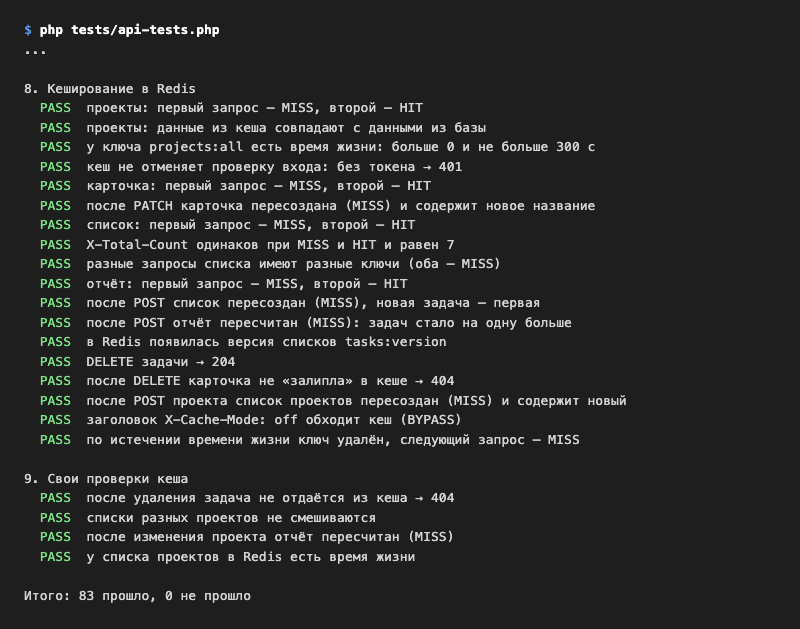

---

## Вывод

К приложению подключён Redis, реализован кеш по схеме cache-aside для четырёх видов данных (справочник, карточка, список с параметрами, отчёт) с продуманными ключами, временем жизни и инвалидацией при изменениях; приложение остаётся работоспособным при недоступности Redis. Измерения на 500 тысячах задач показали, что кеширование даёт огромный выигрыш для тяжёлых запросов (поиск, сортировка, отчёт: ускорение в 15–45 раз, пропускная способность выросла в десятки раз) и не даёт выигрыша для запросов, которые база выполняет мгновенно (карточка по номеру). Эффективность кеша определяется стоимостью исходного запроса, частотой его повторения и долей попаданий, а цена кеша — устаревшие данные и необходимость инвалидации: поэтому кешировать нужно не всё подряд, а то, что подтверждено измерением.

---

**Структура репозитория:**
```
lab10/
├── README.md
├── src/                          # приложение: клиент и сервер из лабораторной №9 + кеш
│   ├── docker-compose.yml        # PostgreSQL 16 и Redis 7
│   ├── app/Core/Cache.php        # кеш в Redis
│   ├── app/Models/               # CachedTaskRepository, CachedProjectRepository, ReportRepository
│   ├── sql/                      # schema.sql, seed.sql, bigdata.sql (500 000 задач)
│   ├── bin/                      # reset-db, load-bigdata, redis-check, cache-demo, benchmark
│   └── tests/api-tests.php       # автотесты (83 проверки)
├── images/                       # скриншоты и диаграммы
└── docs/
    ├── caching.md                # что кешируем, ключи, TTL, инвалидация
    └── benchmark.md              # методика и результаты измерений
```
