# Лабораторная работа №11
## Асинхронная обработка данных

### Цель работы

Изучить принципы асинхронной обработки данных в информационных системах, реализовать выполнение фоновых задач с помощью очереди сообщений в Redis, разработать Worker-процесс, который эти задачи обрабатывает, и встроить асинхронные операции в веб-приложение.

---

## Краткое описание выполненного задания

К системе из лабораторной работы №10 («Система управления задачами команды»: клиент, PHP-сервер, PostgreSQL, авторизация, кеш в Redis) добавлена очередь фоновых задач. Тот же Redis, который хранит кеш, теперь хранит и очередь: задача кладётся в список (`LPUSH`), а отдельный процесс, воркер (`bin/worker.php`), достаёт её надёжной командой `BLMOVE`, выполняет и подтверждает.

Асинхронно выполняются две операции:

1. **Уведомление при смене статуса задачи** (образец, разобранный в теории). `PATCH /api/tasks/{id}` с новым статусом кладёт в очередь задачу `notification` и сразу отвечает; воркер записывает уведомления руководителям в таблицу `notifications`. Уведомление, которое «отправляется» 2 секунды, перестало задерживать ответ: 2048 мс без очереди и 18 мс с очередью.
2. **Построение отчёта в CSV** (вторая операция на выбор). `POST /api/reports` оформляет заявку и отвечает кодом 202, воркер строит файл, клиент спрашивает состояние через `GET /api/reports/{id}` и скачивает готовый файл.

Воркер умеет повторять неудавшиеся задачи с растущей паузой (2, 4, 8 секунд), отправлять безнадёжные в «мёртвую» очередь, возвращать в очередь задачи, застрявшие после аварийного завершения, и корректно останавливаться по Ctrl+C. Автотесты API (117 проверок, из них 34 про очередь, воркер и отчёт) проходят.

## Предметная область

Демонстрационный вариант 0: «Система управления задачами команды» (в вашей работе здесь заполненная карточка вашей предметной области и 2–3 предложения о переносе: что изменили и как проверили).

| Что определить | Значение |
|----------------|----------|
| Приложение | система из лабораторной работы №10: клиент, REST API на PHP, PostgreSQL, вход по токену, кеш |
| Очередь сообщений | Redis 7, клиент для PHP — расширение phpredis; надёжная очередь на списках (`LPUSH` + `BLMOVE`) |
| Worker | `bin/worker.php`: отдельный PHP-процесс с бесконечным циклом |
| Операция 1 (образец) | уведомление руководителям при смене статуса задачи |
| Операция 2 (на выбор) | построение отчёта в CSV |

---

**Запуск:**

```bash
cd lab11/src
docker compose up -d                                     # PostgreSQL 16 и Redis 7
php bin/reset-db.php                                     # таблицы, данные, очистка кеша и очереди
php bin/queue-check.php                                  # очередь работает: push, reserve, ack
PHP_CLI_SERVER_WORKERS=4 php -S localhost:8000 -t public # сервер на 4 процессах (окно 1)
php bin/worker.php                                       # воркер (окно 2)
```

Клиент: `http://localhost:8000/client/` (вход `anna@example.com`, пароль `123456`). Автотесты: `php tests/api-tests.php` (воркер на время тестов остановите: тесты запускают его сами). Если порты 5432 или 6379 заняты, используйте `DB_PORT=5433 REDIS_PORT=6380 docker compose up -d` и передайте те же переменные серверу и воркеру.

---

## Описание механизма очередей

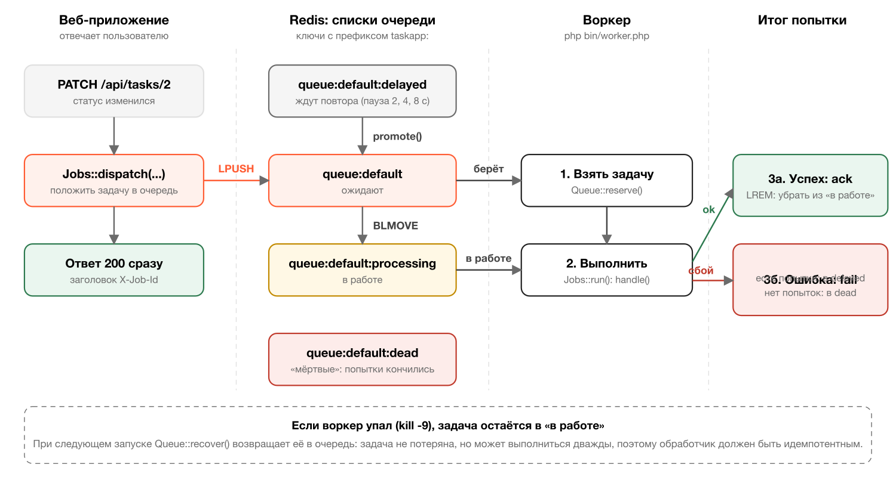

**Очередь** — «список дел»: тот, кто поставил задачу, не ждёт её выполнения. Обработчик HTTP-запроса кладёт в очередь маленькое сообщение и сразу отвечает пользователю, а воркер забирает сообщения по одному и выполняет. Очередь нужна там, где операция долгая (письмо, отчёт, обработка файла), нестабильная (внешний сервис иногда не отвечает) или не обязана быть готовой до ответа.

Очередь устроена на четырёх ключах Redis (с префиксом `taskapp:`):

| Ключ | Тип | Что хранит |
|------|-----|-----------|
| `queue:default` | список | ожидающие задачи: кладём слева (`LPUSH`), берём справа, поэтому задачи идут по порядку |
| `queue:default:processing` | список | задачи «в работе»: взятая воркером задача не пропадает, а перекладывается сюда |
| `queue:default:delayed` | отсортированное множество | задачи, которые будут повторены после паузы; число — время, когда их пора вернуть |
| `queue:default:dead` | список | «мёртвая» очередь: задачи, не выполненные за все попытки |

Задача — это JSON-строка: `{"id": "...", "type": "notification", "payload": {...}, "attempts": 0, "created_at": "..."}`. В `payload` лежит только нужное для обработки (номера и тексты), а не целые записи из базы: к моменту выполнения запись может измениться.

### Надёжность: почему `BLMOVE`, а не просто «достать»

Если воркер достанет задачу командой `RPOP` и упадёт, задача пропадёт навсегда. Поэтому `Queue::reserve` не достаёт, а **перекладывает** задачу из очереди в список «в работе» одной неделимой командой `BLMOVE`. Выполненная задача удаляется оттуда подтверждением (`Queue::ack`, команда `LREM`). Если воркер упал посреди работы, задача осталась в «в работе», и при следующем запуске `Queue::recover` вернёт её в очередь (ниже, на скриншоте с `kill -9`).

Цена такой надёжности: после сбоя задача может выполниться **дважды** (воркер успел записать результат, но не успел подтвердить). Поэтому обработчик должен быть **идемпотентным**: повторное выполнение не должно давать второго результата. В работе это сделано через `UNIQUE (job_id, user_id)` и `ON CONFLICT DO NOTHING` в таблице `notifications`.

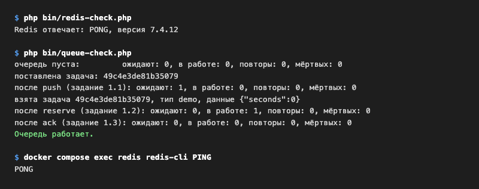

---

## Описание реализации Worker-процесса

Воркер (`bin/worker.php`) — обычный PHP-скрипт, не связанный с веб-сервером. Его цикл:

```php
while ($running) {
    Queue::promote($queue);                    // вернуть в очередь задачи, у которых прошла пауза перед повтором
    $reserved = Queue::reserve($queue, 2);     // взять задачу (ждать не дольше 2 секунд)
    if ($reserved === null) { continue; }
    [$job, $raw] = $reserved;
    try {
        Jobs::run($job);                       // выполнить: класс обработчика выбирается по типу задачи
        Queue::ack($raw, $queue);              // успех: убрать из «в работе»
    } catch (Throwable $e) {
        Queue::fail($job, $raw, $e->getMessage(), $queue);   // ошибка: повторить позже или в «мёртвую» очередь
    }
}
```

| Возможность | Как сделано |
|-------------|-------------|
| Выбор обработчика | `Jobs::handlers()`: `notification` → `NotificationJob`, `report` → `ReportJob`; новую операцию добавляют классом с методом `handle()` и строкой в реестре |
| Повторы | `Queue::fail`: попыток не больше трёх; пауза растёт вдвое (2 с, 4 с, 8 с) и хранится в `queue:default:delayed` |
| «Мёртвая» очередь | после третьей неудачи задача с текстом ошибки попадает в `queue:default:dead`; смотреть: `php bin/queue-stats.php --dead` |
| Восстановление после сбоя | при запуске `Queue::recover` возвращает в очередь задачи, застрявшие в «в работе» |
| Корректная остановка | обработка `SIGTERM` и `SIGINT`: воркер доделывает текущую задачу и выходит |
| Несколько воркеров | можно запустить сколько угодно: `BLMOVE` атомарна, одну задачу получит один воркер |

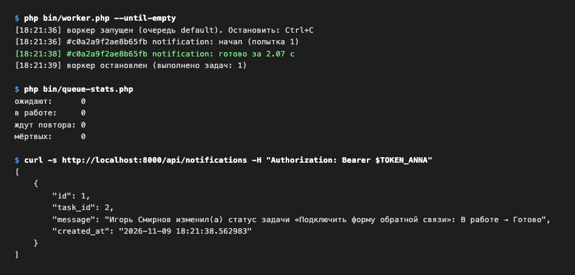

### Ошибки и повторы

Задача `--fail` всегда падает. Воркер не останавливается: пробует три раза с паузами 2 и 4 секунды, затем кладёт задачу в «мёртвую» очередь вместе с текстом ошибки:

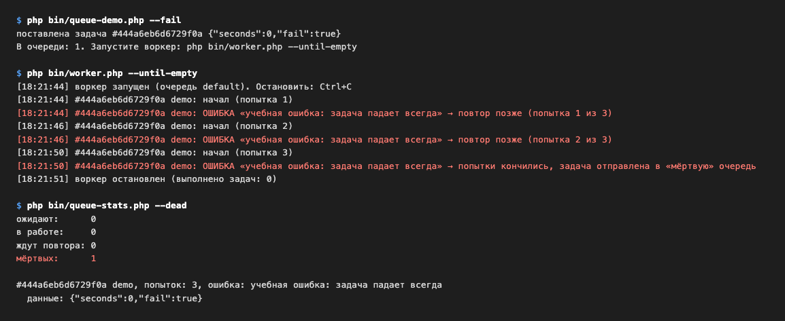

### Сбой воркера: `kill -9`

Долгая задача (20 секунд), воркер убит посреди работы. Задача осталась в «в работе» (`в работе: 1`), новый воркер вернул её в очередь и выполнил:

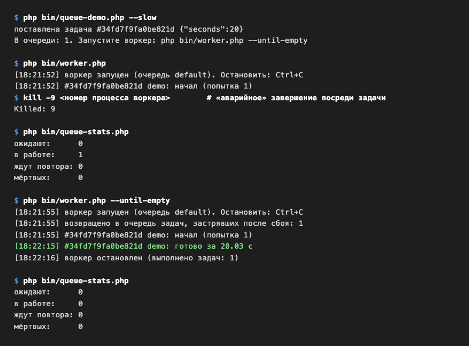

---

## Описание асинхронной обработки операций

### Операция 1. Уведомление при смене статуса

Обработчик `TaskApiController::update` сравнивает старый и новый статус; если статус изменился, вызывает `Jobs::dispatch('notification', [...])` и добавляет в ответ заголовок `X-Job-Id` с номером задачи. Пользователь получает ответ сразу. Позже воркер (`NotificationJob`) записывает уведомление в таблицу `notifications` каждому руководителю, кроме автора изменения. Прочитать свои уведомления можно через `GET /api/notifications`.

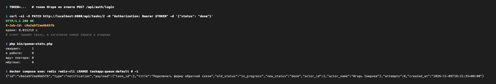

Для сравнения есть режим обхода очереди: заголовок `X-Queue-Mode: sync` просит сервер выполнить уведомление прямо в запросе (работает только при `debug = true`). Так видно, что получил бы пользователь без очереди:

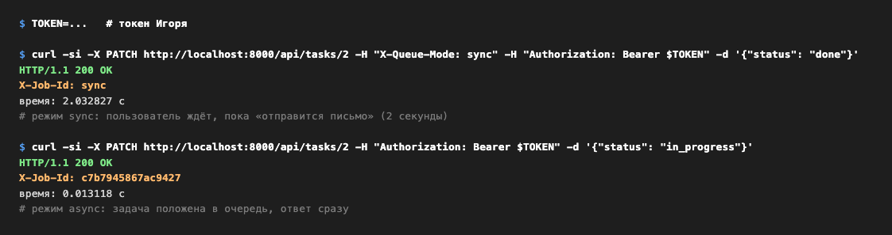

### Операция 2. Отчёт в CSV

`POST /api/reports` создаёт заявку (таблица `report_requests`, статус `queued`), ставит задачу `report` и отвечает кодом **202 Accepted** («принято, но ещё не выполнено») с заголовком `Location`. Воркер переводит заявку в `processing`, строит файл `storage/reports/report-<номер>.csv` и ставит `done` (или `failed` с текстом ошибки). Клиент опрашивает `GET /api/reports/{id}` и скачивает файл через `GET /api/reports/{id}/download` (пока файл не готов, ответ 409). Заявку видит только автор и руководитель.

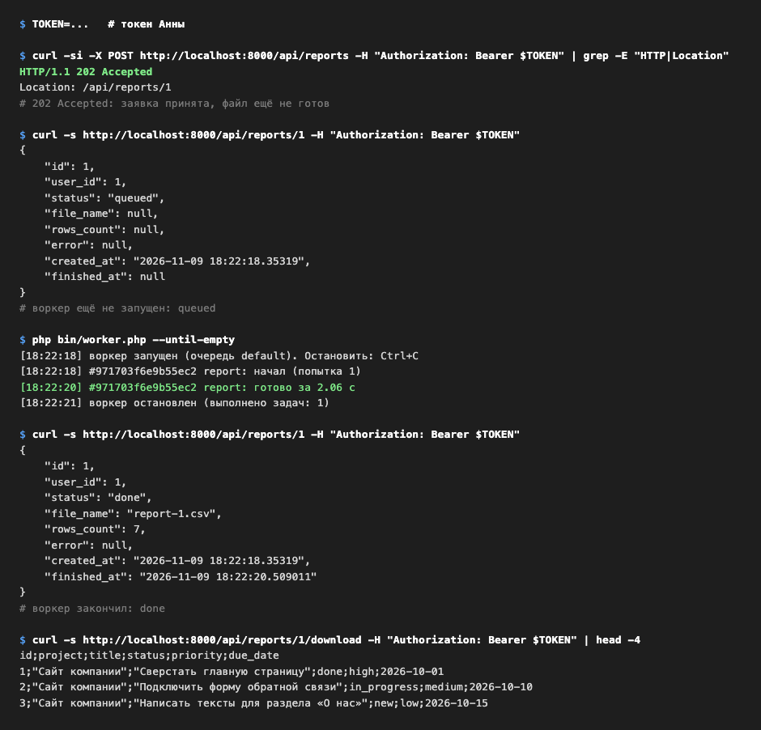

| Адрес | Что делает | Успешный код |
|-------|-----------|--------------|
| `POST /api/reports` | заказать отчёт | 202 |
| `GET /api/reports/{id}` | состояние заявки: `queued`, `processing`, `done`, `failed` | 200 |
| `GET /api/reports/{id}/download` | скачать готовый CSV | 200 (409, пока не готов) |
| `GET /api/notifications` | свои уведомления | 200 |

---

## Результаты измерений

Скрипт `php bin/bench-async.php` пять раз меняет статус одной задачи в каждом из режимов; «отправка письма» занимает 2 секунды (имитация), затем заказывает отчёт при запущенном воркере.

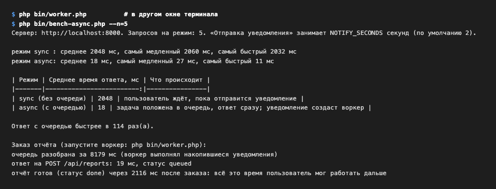

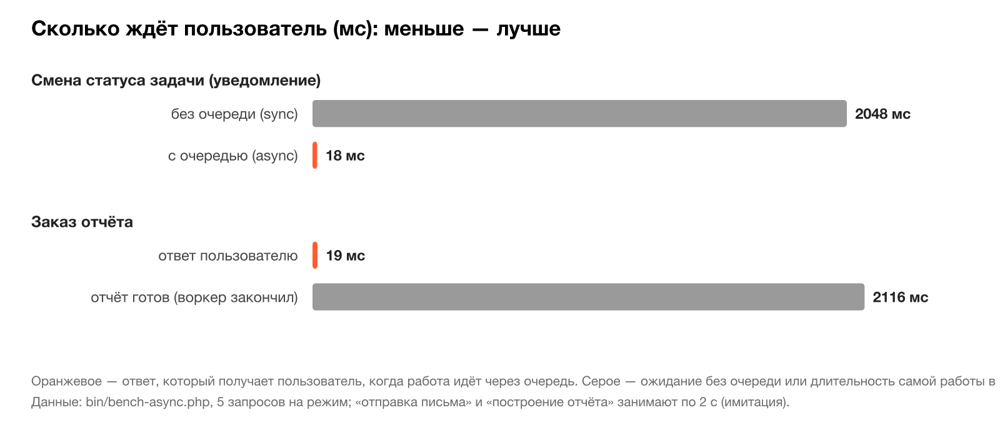

| Что измерено | Без очереди | С очередью |
|--------------|------------:|-----------:|
| смена статуса задачи, среднее время ответа | 2048 мс | 18 мс |
| заказ отчёта: ответ пользователю | — | 19 мс |
| заказ отчёта: файл готов | — | около 2 с после заказа |

**Анализ.** Очередь не ускоряет саму работу: уведомление и отчёт по-прежнему занимают по 2 секунды. Она отделяет работу от ответа: пользователь ждёт 18 мс вместо 2 секунд, а сервер за это время успевает принять следующие запросы. Цена: результат появляется позже («согласованность в конечном счёте»), нужен отдельный процесс-воркер, появляется вопрос «что если задача не выполнилась». Перед замером отчёта скрипт ждёт, пока воркер разберёт накопившиеся уведомления: очередь одна, и отчёт встаёт в её конец.

---

## Тестирование

```bash
php tests/api-tests.php
```

Тесты сами запускают воркер (`--until-empty`) и сами очищают очередь. Проверки по очереди (разделы 10–13): ответ быстрый и есть `X-Job-Id`; задача лежит в очереди, а уведомления ещё нет; после воркера уведомление появилось у руководителя и не появилось у автора; режим `sync`; неизвестная задача после трёх попыток попала в «мёртвую» очередь; нестабильная задача выполнилась с третьей попытки; задача, застрявшая после «сбоя», возвращена и выполнена; повторное выполнение не создало второго уведомления; отчёт: 202, `queued`, 409 до готовности, `done`, файл CSV, права доступа.

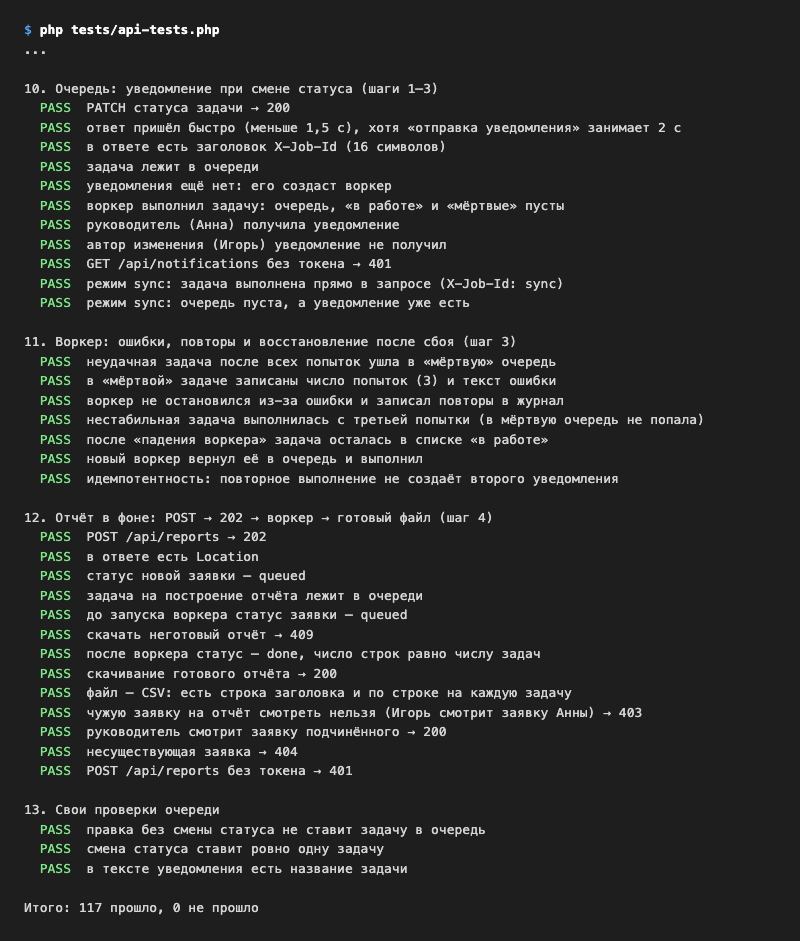

Подробности устройства очереди, обоснование выбора и сравнение с другими способами — в [docs/queue.md](./docs/queue.md).

---

## Вывод

Реализована асинхронная обработка на очереди сообщений в Redis: постановка задач (`Queue::push`), надёжное получение (`BLMOVE`) и подтверждение (`ack`), Worker-процесс с повторами, «мёртвой» очередью, восстановлением после сбоя и корректной остановкой. Две операции приложения (уведомление о смене статуса и построение отчёта) вынесены в фон: ответ пользователю приходит за 18–19 мс вместо 2 секунд, а работу выполняет воркер. Автотесты (117 проверок) подтверждают работу очереди, воркера и обработки ошибок.

Главное, что показала работа: очередь не делает операцию быстрее, она делает быстрым ответ, но взамен приходится думать о сбоях. Повторы требуют идемпотентных обработчиков, а «мёртвую» очередь кто-то должен разбирать.
