# Лабораторная работа №12
## Сбор и обработка событий информационной системы

### Цель работы

Изучить принципы регистрации событий в информационных системах, реализовать механизм сбора пользовательских событий, сформировать журнал событий и подготовить данные для последующего анализа.

---

## Краткое описание выполненного задания

К системе из лабораторной работы №11 («Система управления задачами команды»: клиент, PHP-сервер, PostgreSQL, авторизация, кеш и очередь в Redis) добавлен **журнал событий**. Класс `Events` записывает в таблицу `events` десять типов событий: вход (`login`), неудачный вход (`login_failed`), выход (`logout`), создание, изменение и удаление задач и проектов (`task_*`, `project_*`) и ошибки сервера (`server_error`). Запись события не может сломать запрос пользователя, а пароли и токены в журнал не попадают. Журнал читает руководитель через `GET /api/events` (фильтры по типу, участнику и периоду, сортировка, страницы); остальным ответ 403.

Для анализа журнал наполнен 20 000 тестовыми событиями за 30 дней (`bin/seed-events.php`). Подготовлено шесть SQL-запросов: события по типам, самые активные участники, события по дням, категории, доля ошибок по дням и активность по часам. Анализ показал, что чаще всего меняют задачи (43 % всех событий), по выходным активность в 4 раза ниже, чем в будни, а 9 ноября была авария: 76 ошибок за день (8,3 % событий вместо обычных 0,4–1,4 %). Автотесты API (172 проверки, из них 55 про журнал) проходят.

## Предметная область

Демонстрационный вариант 0: «Система управления задачами команды» (в вашей работе здесь заполненная карточка вашей предметной области и 2–3 предложения о переносе: что изменили и как проверили).

| Что определить | Значение |
|----------------|----------|
| Приложение | система из лабораторной работы №11: клиент, REST API на PHP, PostgreSQL, вход по токену, кеш, очередь |
| Где хранится журнал | таблица `events` в PostgreSQL (индексы по времени, по типу вместе со временем и по участнику) |
| Что регистрируем | вход, выход, неудачный вход, создание, изменение и удаление задач и проектов, ошибки сервера |
| Данные для анализа | 20 000 тестовых событий за 30 дней (`bin/seed-events.php`) |

---

**Запуск:**

```bash
cd lab12/src
docker compose up -d                                     # PostgreSQL 16 и Redis 7
php bin/reset-db.php                                     # таблицы (в том числе events), данные, очистка кеша и очереди
php bin/events-check.php                                 # запись событий работает, секретов в журнале нет
PHP_CLI_SERVER_WORKERS=4 php -S localhost:8000 -t public # сервер на 4 процессах
php bin/seed-events.php                                  # 20 000 тестовых событий для анализа
php bin/analytics.php                                    # SQL-запросы анализа
```

Клиент: `http://localhost:8000/client/` (вход `anna@example.com`, пароль `123456`). Последние события журнала в терминале: `php bin/events-tail.php`. Автотесты: `php tests/api-tests.php`. Если порты 5432 или 6379 заняты, используйте `DB_PORT=5433 REDIS_PORT=6380 docker compose up -d` и передайте те же переменные серверу и скриптам.

---

## Структура событий и журнала

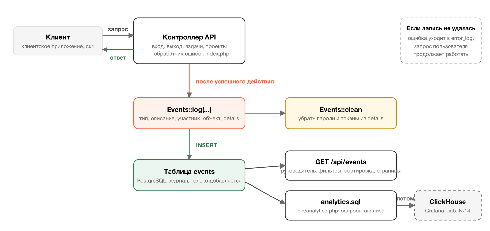

Событие — запись о том, что **произошло**: когда, что, кто и над чем. Все события имеют общий набор полей и хранятся в одной таблице:

| Поле | Что это |
|------|---------|
| `occurred_at` | дата и время (ставит база; тип `TIMESTAMPTZ`: время хранится с часовым поясом) |
| `type`, `category` | что произошло (`task_updated`) и группа: `auth` (вход и выход), `data` (изменение данных), `system` (ошибки) |
| `user_id` | кто выполнил действие; пусто, если участник неизвестен (вход с несуществующим email, ошибка до входа) |
| `entity_type`, `entity_id` | над чем выполнено действие: `task` и номер, `project` и номер, `user` и номер |
| `description` | описание словами: «Изменена задача №2 (status)» |
| `details` | дополнительные данные в формате JSONB: у каждого типа свои |
| `ip`, `request_id` | адрес, с которого пришёл запрос, и номер запроса (тот же приходит клиенту в заголовке ответа `X-Request-Id`) |

Подробный перечень событий, состав их данных и правила записи — в [docs/events.md](./docs/events.md).

Правила, которые соблюдает журнал:

- **не ломает приложение**: запись обёрнута в `try/catch`, при ошибке сообщение уходит в `error_log`, запрос пользователя продолжается;
- **не хранит секреты**: `Events::clean` удаляет из `details` ключи `password`, `password_hash`, `token`, `authorization`, `secret` (в любом регистре и во вложенных массивах);
- **только добавляется**: записи не изменяют и не удаляют;
- **пишется после успешного действия**: удаление несуществующей задачи (404) событием не является.

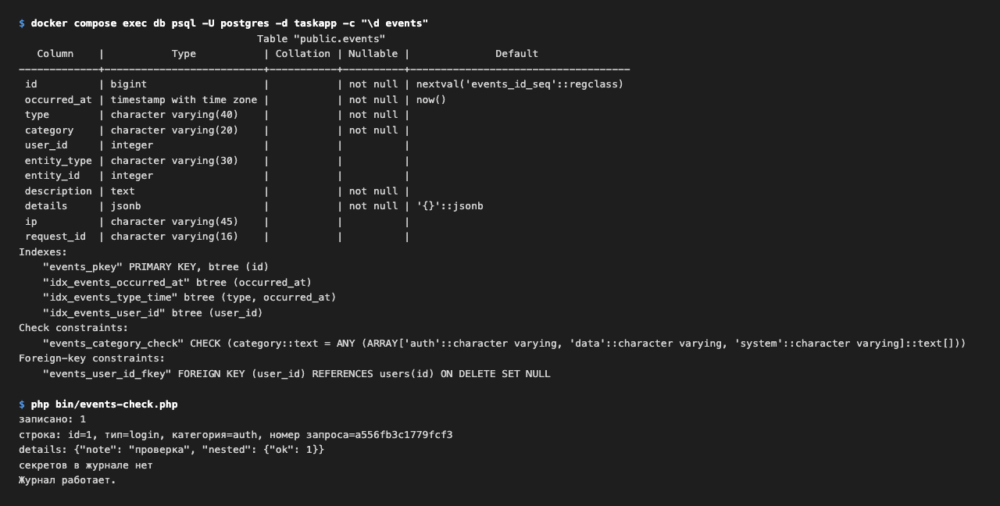

---

## Реализация регистрации событий

Метод `Events::log($тип, $описание, $параметры)` вставляет событие в таблицу. Автор определяется по токену запроса (`current_user()`); там, где токена ещё нет (вход) или уже нет (выход после отзыва токена), участник передаётся явно или событие пишется до отзыва.

```php
Events::log('task_updated', 'Изменена задача №' . $updated['id'] . ' (' . implode(', ', $changed) . ')', [
    'entity_type' => 'task',
    'entity_id'   => $updated['id'],
    'details'     => ['changed' => $changed, 'status' => [$task['status'], $updated['status']]],
]);
```

| Где | Какие события |
|-----|---------------|
| `AuthController::login` | `login` (с передачей участника), `login_failed` (email и причина `wrong_password` или `unknown_email`, пароль не пишется) |
| `AuthController::logout` | `logout` (до `Auth::revoke`) |
| `TaskApiController` | `task_created`, `task_updated` (в `details.changed` список изменённых полей), `task_deleted` (с названием, взятым до удаления) |
| `ProjectApiController` | `project_created`, `project_updated`, `project_deleted` |
| `public/index.php` | `server_error`: класс исключения, файл и строка, метод и путь запроса (без строки запроса) |

Номер запроса `request_id` одинаков у всех событий одного запроса и отдаётся клиенту в заголовке `X-Request-Id`: по нему событие в журнале связывают с запросом, о котором сообщил пользователь.

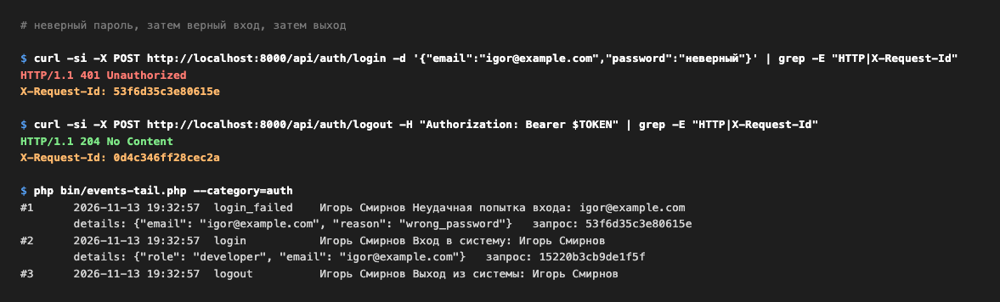

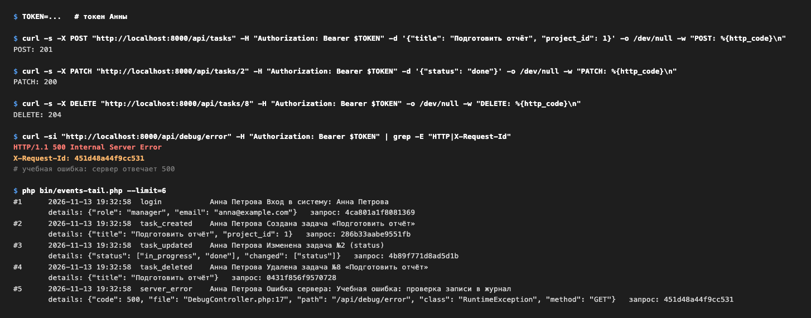

### Просмотр журнала

`GET /api/events` доступен только руководителю (`manager`). Параметры: `type`, `user_id`, `from`, `to` (даты `ГГГГ-ММ-ДД`, обе границы включительно), `sort` (`time` или `-time`, по умолчанию новые сверху), `limit` (по умолчанию 50, не больше 500), `offset`. Число подходящих событий приходит в заголовке `X-Total-Count`. Неверный параметр даёт 422 с описанием, значения подставляются в SQL параметрами (в автотестах есть проверка «SQL-инъекция не срабатывает»).

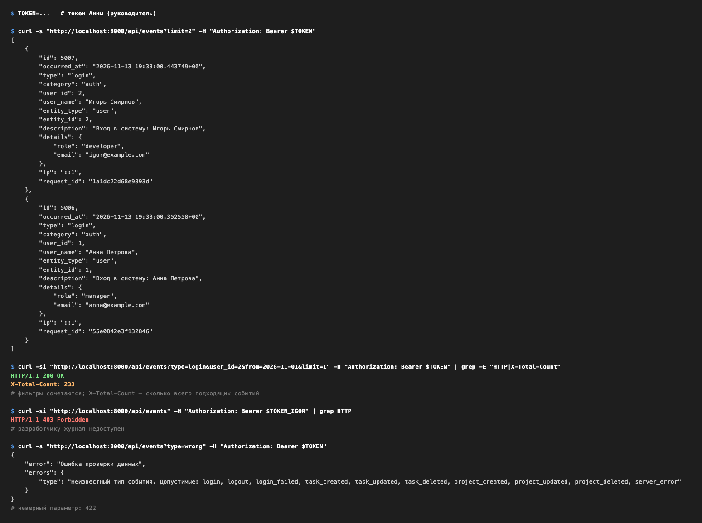

---

## SQL-запросы для аналитической обработки

Журнал наполнен командой `php bin/seed-events.php`: 20 000 событий за 30 дней. Данные устроены как в живой системе: по будням активность выше, чем по выходным, днём выше, чем ночью, участники работают по-разному, в один из дней случилась «авария». Тестовые события помечены `details.synthetic = true`.

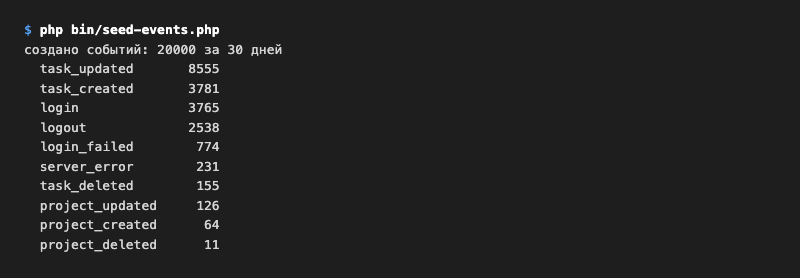

Запросы лежат в `sql/analytics.sql`, выполняются командой `php bin/analytics.php`:

| № | Запрос | Что считает |
|---|--------|-------------|
| 0 | доля ошибок по дням (образец) | сколько событий и ошибок за день, процент ошибок |
| 1 | события по типам | `COUNT(*)` и `GROUP BY type` |
| 2 | пять самых активных участников | `JOIN` с `users`, `GROUP BY`, `LIMIT 5` |
| 3 | события по дням за 14 дней | `occurred_at::date`, `GROUP BY day` |
| 4 | распределение по категориям | число и доля в процентах (`SUM(COUNT(*)) OVER ()`) |
| 5 | активность по часам суток (свой запрос) | `EXTRACT(HOUR FROM occurred_at)` |

```sql
-- 4. Распределение событий по категориям (число и доля в процентах)
SELECT category,
       COUNT(*) AS total,
       ROUND(100.0 * COUNT(*) / SUM(COUNT(*)) OVER (), 1) AS percent
FROM events
GROUP BY category
ORDER BY total DESC;
```

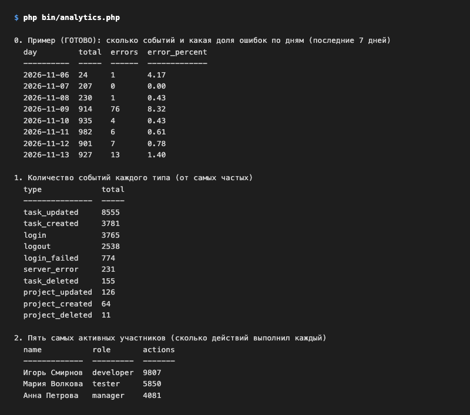

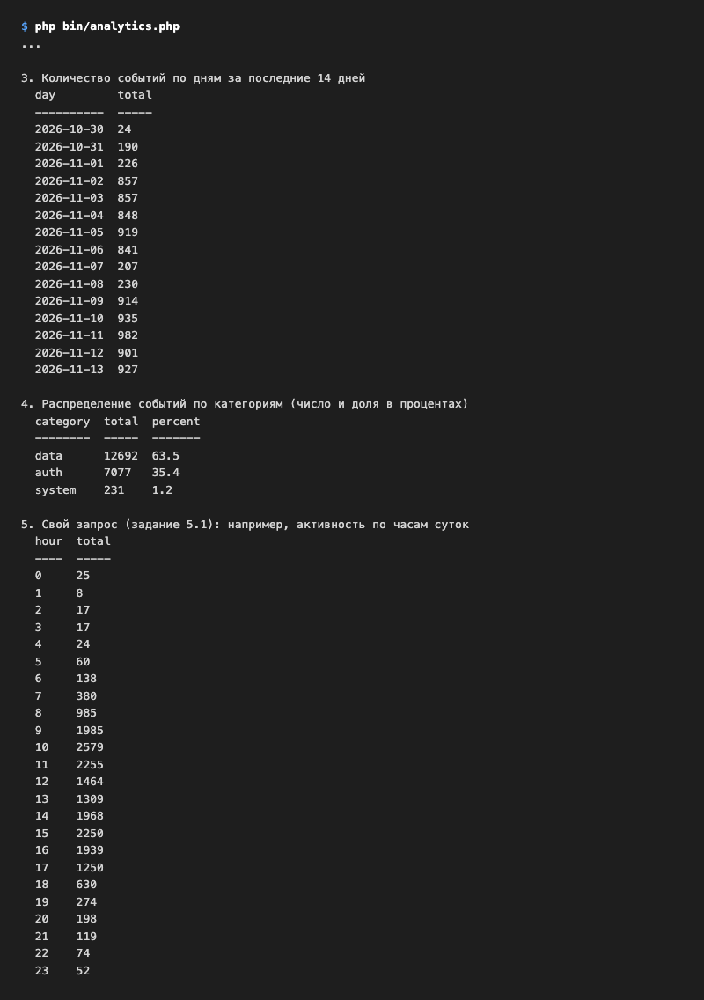

---

## Анализ структуры событий

Подробный анализ с таблицами и выводами — в [docs/events.md](./docs/events.md). Главное:

| Вопрос | Что показали данные |
|--------|---------------------|
| Какие события самые частые | `task_updated` (8555, 43 %), `task_created` (3781), `login` (3765): работа с задачами и входы составляют 82 % журнала |
| Кто самый активный | Игорь Смирнов (разработчик): 9807 действий; Мария Волкова: 5850; Анна Петрова (руководитель): 4081 |
| Как меняется активность | будни: в среднем 838 событий в день; выходные: 197 (в 4,3 раза меньше) |
| Когда пики | 9–11 часов (в 10 часов 2579 событий) и 15–16 часов, спад в 13 часов (1310), ночью почти тишина |
| Где аномалия | 9 ноября: 76 ошибок за день (8,3 % событий) при обычных 4–13 |
| Подозрительная активность | 774 неудачных входа, из них 223 с несуществующих адресов (40 разных IP-адресов): похоже на подбор |

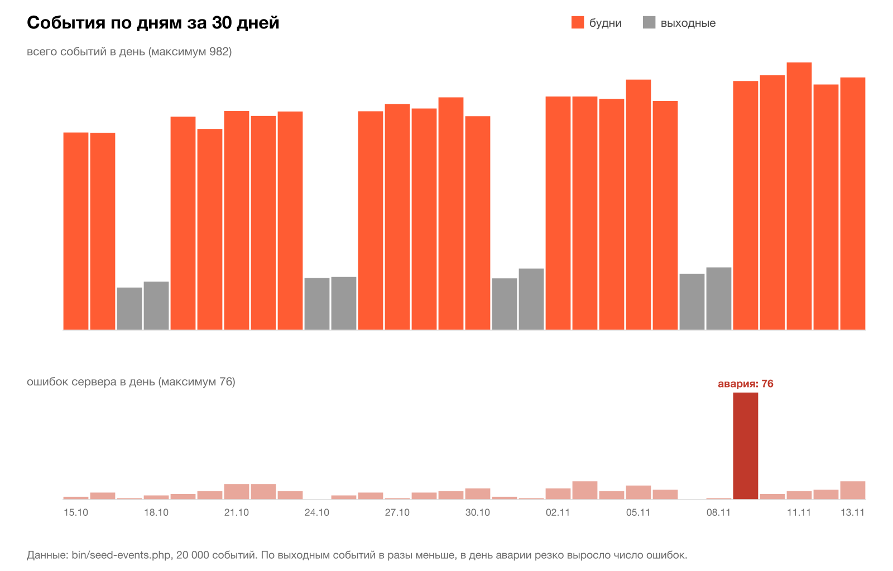

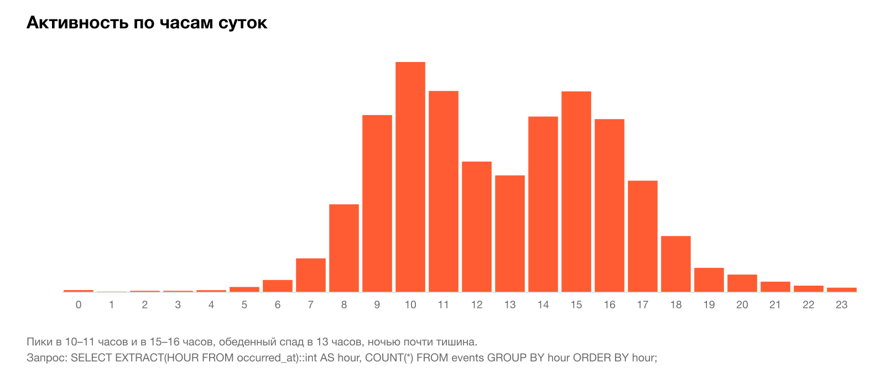

---

## Тестирование

```bash
php tests/api-tests.php
```

Разделы 14–17 проверяют журнал: запись каждого типа события (вход, неудачный вход, выход, задачи, проекты, ошибка), отсутствие пароля и токена в записи, совпадение номера запроса в событии и в заголовке ответа, то, что неудавшееся действие событием не записывается, права и фильтры API, постраничный вывод, защиту от SQL-инъекций, корректность каждого аналитического запроса (суммы сверяются с числом событий в базе).

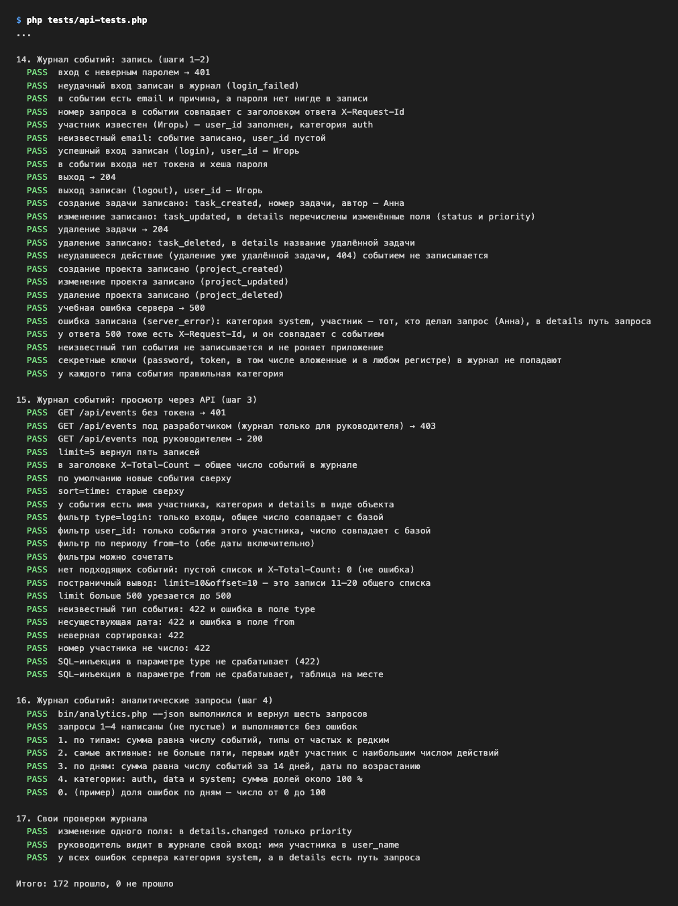

---

## Вывод

Реализован журнал событий информационной системы: класс `Events` записывает вход, выход, неудачный вход, создание, изменение и удаление объектов и ошибки сервера в таблицу PostgreSQL с индексами; запись не ломает запрос и не пропускает секреты; журнал доступен руководителю через API с фильтрами, сортировкой и страницами. Подготовлены шесть SQL-запросов и тестовые данные на 20 000 событий. Автотесты (172 проверки) подтверждают работу журнала и запросов.

Анализ показал, что журнал событий отвечает на вопросы, которые по состоянию приложения не увидеть: кто и что делает чаще всего, когда пики нагрузки, не было ли аварии и не подбирает ли кто-то пароль. Для мониторинга полезны доля ошибок за день (порог оповещения, например, 3 %), число неудачных входов с одного адреса за час и резкое падение числа событий в рабочее время. Когда событий станут миллионы, считать такие вопросы в основной базе станет тяжело: в лабораторной работе №14 события переносятся в ClickHouse, а результаты показываются в Grafana.
