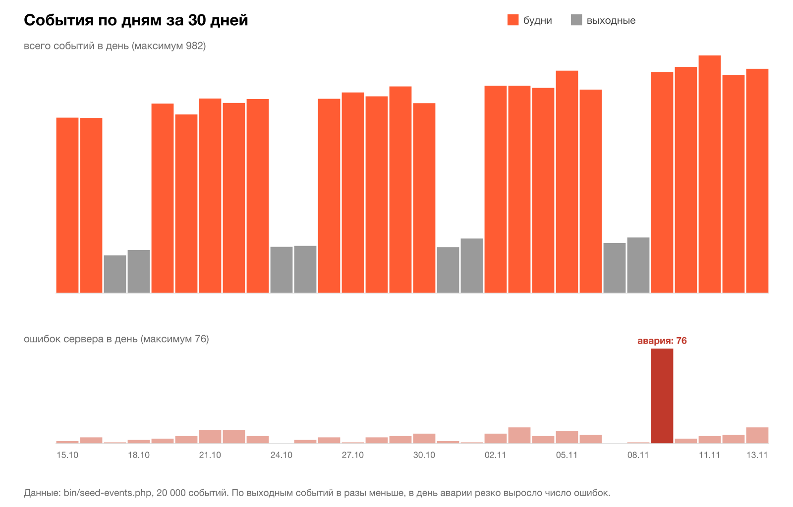
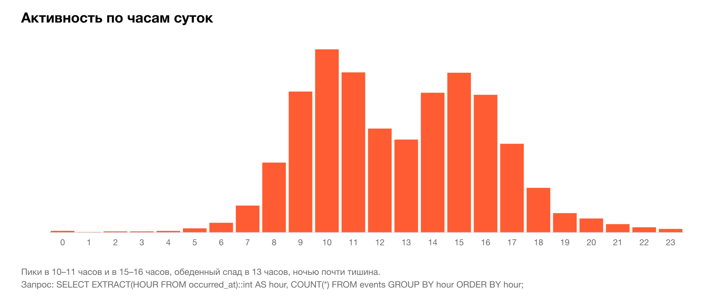

# Журнал событий: перечень, состав данных и анализ

## 1. Перечень регистрируемых событий

| Тип | Категория | Когда записывается | Кто (`user_id`) | Объект | Что в `details` | Зачем нужно |
|-----|-----------|--------------------|-----------------|--------|-----------------|-------------|
| `login` | auth | успешный вход | вошедший участник | `user` и его номер | email, роль | кто и когда работает; время начала сеансов |
| `login_failed` | auth | неверный пароль или несуществующий email | участник, если такой email есть; иначе пусто | `user` (если известен) | email, причина (`wrong_password`, `unknown_email`) | обнаружить подбор пароля |
| `logout` | auth | выход | вышедший участник | `user` | — | завершение сеансов |
| `task_created` | data | после успешного создания задачи | автор запроса | `task` и номер | название, номер проекта | кто и сколько создаёт задач |
| `task_updated` | data | после успешного изменения задачи | автор запроса | `task` | `changed`: список изменённых полей; для статуса: старое и новое значение | какие поля меняют чаще всего; история смены статусов |
| `task_deleted` | data | после успешного удаления задачи | автор запроса (руководитель) | `task` | название удалённой задачи | аудит: кто удалил (после удаления записи в базе уже нет) |
| `project_created`, `project_updated`, `project_deleted` | data | после успешной операции над проектом | руководитель | `project` | название проекта | аудит изменений справочника |
| `server_error` | system | в обработчике запроса возникло исключение (ответ 500 или 503) | тот, кто делал запрос, если вошёл | — | класс ошибки, файл и строка, метод, путь запроса, код | мониторинг: доля ошибок, места сбоев |

### Общий состав записи

`occurred_at` (когда), `type` и `category` (что), `user_id` (кто), `entity_type` и `entity_id` (над чем), `description` (словами), `details` (JSONB, у каждого типа своё), `ip` (откуда), `request_id` (номер запроса, он же заголовок `X-Request-Id`).

### Ответы на вопросы шага 1

- **Почему `user_id` может быть пустым?** Неудачный вход с несуществующим email или ошибка до входа не имеют известного автора. Если бы поле было обязательным, такие события нельзя было бы записать, а они как раз важны (подбор пароля, сбои).
- **Какие данные нельзя класть в событие?** Пароли, хеши паролей, токены, заголовок `Authorization`, любые секреты: журнал читают многие и хранят годами. `Events::clean` удаляет такие ключи из `details`, в том числе во вложенных массивах и в любом регистре.
- **Почему событие записывается только после успешного действия?** Событие описывает факт, который уже произошёл. Если задачу не удалось удалить (404 или 403), записи «удалена» быть не должно, иначе по журналу нельзя будет восстановить, что на самом деле случилось.

## 2. Как работает запись

1. Контроллер выполняет действие (создаёт задачу, меняет проект...) и убеждается, что оно удалось.
2. Вызывает `Events::log(тип, описание, [объект, details])`.
3. `Events::log` проверяет тип по списку `Events::TYPES`, определяет автора по токену запроса, очищает `details` от секретов (`Events::clean`) и вставляет строку в таблицу `events`.
4. Если на каком-то шаге произошла ошибка (неизвестный тип, база недоступна), сообщение записывается в `error_log`, а запрос пользователя продолжается как ни в чём не бывало: журнал не должен ломать приложение.

Номер запроса (`request_id`) создаётся один раз на запрос и одинаков у всех событий этого запроса. Клиент получает его в заголовке `X-Request-Id`. Если пользователь пожаловался «мне вернулась ошибка», по номеру из заголовка в журнале находят всё, что произошло во время его запроса.

## 3. Результаты анализа (тестовые данные: 20 000 событий за 30 дней)

Данные создала команда `php bin/seed-events.php`; числа получены командой `php bin/analytics.php` (у вас они будут немного другими: случайные данные зависят от дня запуска, но закономерности те же).

### 3.1. Какие события происходят чаще всего

| Тип | События | Доля |
|-----|--------:|-----:|
| `task_updated` | 8555 | 42,8 % |
| `task_created` | 3781 | 18,9 % |
| `login` | 3765 | 18,8 % |
| `logout` | 2538 | 12,7 % |
| `login_failed` | 774 | 3,9 % |
| `server_error` | 231 | 1,2 % |
| `task_deleted` | 155 | 0,8 % |
| `project_updated` | 126 | 0,6 % |
| `project_created` | 64 | 0,3 % |
| `project_deleted` | 11 | 0,06 % |

Самое частое событие — изменение задачи: задачи в системе постоянно двигаются по статусам. Входов (3765) заметно больше, чем выходов (2538): большинство участников не нажимает «Выйти», а просто закрывает вкладку, и токен истекает сам. Это хорошее наблюдение для аналитика: по выходам нельзя судить о длительности сеанса. Удаление и изменение проектов случается редко: это справочник, и менять его могут только руководители.

Что именно меняют в задачах (по полю `details.changed`): статус 3642 раза (43 % изменений), приоритет 1266, срок 1252, описание 1219, название 1176. Статус меняют втрое чаще любого другого поля: это основное рабочее действие.

### 3.2. Самые активные участники

| Участник | Роль | Действий | Изменили задач | Создали задач | Неудачных входов |
|----------|------|---------:|---------------:|--------------:|-----------------:|
| Игорь Смирнов | developer | 9807 | 4358 | 1903 | 277 |
| Мария Волкова | tester | 5850 | 2548 | 1169 | 166 |
| Анна Петрова | manager | 4081 | 1649 | 709 | 108 |

Больше всех действий у разработчика, меньше всех у руководителя: роли определяют и объём работы с задачами, и доступные действия (удалять задачи и менять проекты может только руководитель, поэтому в её 4081 действии есть все 155 удалений). Неудачных входов у самого активного участника больше всего, но их доля (около 2,7 % от действий) у всех примерно одинакова: это обычные опечатки в пароле.

### 3.3. Динамика по дням

- В будни в среднем **838** событий в день (22 дня), по выходным **197** (8 дней): в **4,3 раза меньше**. На графике выходные видны как серые провалы между оранжевыми столбцами.
- Внутри будней активность ровная: за последние две недели от 841 до 982 событий в день.
- Первая строка запроса «за 14 дней» (30 октября) показывает всего 24 события: период считается от текущего момента (`now() - interval '14 days'`), поэтому первый день неполный. Это типичная ошибка при анализе по периодам: неполные крайние дни нужно либо отбрасывать, либо считать границы по датам.



### 3.4. Активность по часам суток (свой запрос)

```sql
SELECT EXTRACT(HOUR FROM occurred_at)::int AS hour, COUNT(*) AS total
FROM events GROUP BY hour ORDER BY hour;
```

Два пика: **9–11 часов** (максимум 2579 событий в 10 часов) и **14–16 часов** (максимум 2250 в 15 часов); обеденный спад в 13 часов (1310). Ночью (0–5 часов) события единичны: меньше 60 в каждый час за все 30 дней. Для эксплуатации это значит: обновления системы и тяжёлые отчёты разумно планировать на ночь, а пики нагрузки ждать утром и после обеда. Событие в 3 часа ночи под чужим именем заслуживает внимания (аномалия).



### 3.5. Аномалии

| Что | Данные | Вывод |
|-----|--------|-------|
| Авария **9 ноября** | 76 ошибок за день (8,3 % событий); в остальные дни 0–13 ошибок (0–1,4 %) | сбой одной из зависимостей (в событиях день аварии: потеря соединения с базой); по доле ошибок это видно сразу |
| Ошибки в обычные дни | в среднем около 5 в день, 1,2 % за 30 дней (вместе с аварией) | допустимый фон |
| Неудачные входы | 774 за месяц; 223 (29 %) с несуществующих адресов, 40 разных IP-адресов | подбор: нормальные участники ошибаются в пароле, но не пробуют чужие адреса |

Запрос доли ошибок по дням (запрос 0) — это и есть простейший мониторинг: стоит проверять его регулярно и оповещать, когда доля ошибок за день выше порога.

### 3.6. Категории

| Категория | События | Доля |
|-----------|--------:|-----:|
| `data` | 12692 | 63,5 % |
| `auth` | 7077 | 35,4 % |
| `system` | 231 | 1,2 % |

Почти две трети журнала — изменение данных, треть — вход и выход, ошибки составляют около процента. Категория `system` — самая важная для мониторинга и при этом самая маленькая: ищутся иголки, а не стога.

## 4. Что использовать для мониторинга

| Показатель | Как считать | Предлагаемый порог оповещения |
|------------|-------------|-------------------------------|
| доля ошибок за день | `server_error` ÷ все события | выше 3 % (обычно 0,5–1,5 %) |
| всплеск ошибок за час | `server_error` за последний час | больше 20 за час |
| подбор пароля | `login_failed` с одного IP за час | 5 и больше |
| «тишина» в рабочее время | событий за час в будни с 9 до 18 | почти ноль: система недоступна |
| необычные действия | `task_deleted` и `project_deleted` вне рабочего времени | любое |

## 5. Чего не хватает в событиях

- **Времени выполнения запроса**: сейчас нельзя найти медленные запросы. Можно добавить в `details` длительность в миллисекундах.
- **Браузера и устройства** (заголовок `User-Agent`): помогло бы отличать людей от скриптов.
- **Старого и нового значения** для всех полей, а не только статуса: полный аудит изменений.
- **Событий просмотра** (открыл карточку, скачал отчёт): сейчас видны только действия, меняющие данные.
- **События воркера**: что фоновая задача выполнена или ушла в «мёртвую» очередь (лабораторная работа №11).

## 6. Что дальше

Когда событий станет миллионы, считать такие запросы в основной базе станет медленно и начнёт мешать самому приложению. В лабораторной работе №14 события переносятся в ClickHouse (аналитическая база, которая быстро группирует и считает), а результаты показываются графиками в Grafana. Структура записи (`type`, `category`, `user_id`, `entity_*`, `details`, `occurred_at`) сохраняется: поэтому её важно продумать сейчас.
