# Лабораторная работа №13
## Реализация полнотекстового поиска

### Цель работы

Изучить принципы работы полнотекстового поиска, подключить OpenSearch, выполнить индексацию данных информационной системы и реализовать поиск по содержимому приложения.

---

## Краткое описание выполненного задания

К системе из лабораторной работы №12 («Система управления задачами команды»: клиент, PHP-сервер, PostgreSQL, авторизация, кеш и очередь в Redis, журнал событий) подключён поисковый сервер OpenSearch 2. Поиск по названию через `ILIKE` не находил слово в другой форме, не прощал опечаток и не искал по описанию и проекту. Теперь:

- задачи (вместе с названием проекта) копируются в индекс OpenSearch с русским анализатором: «форма», «формы» и «формой» ищутся как одно слово;
- копия создаётся полной переиндексацией (`php bin/reindex.php`, новый индекс и переключение псевдонима без остановки поиска) и обновляется в фоне: при создании, изменении и удалении задачи и при переименовании проекта в очередь ставится задача `search_index`, воркер приводит документ в соответствие с PostgreSQL;
- `GET /api/search?q=...` ищет сразу по названию, названию проекта и описанию с разными весами, прощает опечатки, умеет фильтры, страницы и подсветку найденных слов, а при пустом результате отвечает кодом 200 и понятным сообщением;
- если OpenSearch недоступен, поиск продолжает работать через PostgreSQL (упрощённо; заголовок `X-Search-Engine: postgres`);
- каждый поисковый запрос записывается в журнал событий (тип `search`).

Автотесты API (227 проверок, из них 55 про поиск) проходят. Скорость сравнивалась на 20 007 задачах: на таком объёме `ILIKE` ещё достаточно быстр, и главная польза OpenSearch в качестве поиска, а не во времени ответа (подробности ниже).

## Предметная область

Демонстрационный вариант 0: «Система управления задачами команды» (в вашей работе здесь заполненная карточка вашей предметной области и 2–3 предложения о переносе: что изменили и как проверили).

| Что определить | Значение |
|----------------|----------|
| Приложение | система из лабораторной работы №12: клиент, REST API на PHP, PostgreSQL, вход по токену, кеш, очередь, журнал событий |
| Поисковый сервер | OpenSearch 2.17 (один узел, без защиты, только для учёбы); клиент — собственный класс `Search` на curl |
| Объект поиска | задачи вместе с названием проекта |
| Поля поиска | `title` (вес 3), `project_title` (вес 2), `description` (вес 1) |
| Фильтры | `status`, `project_id` |
| Источник правды | PostgreSQL; OpenSearch хранит только копию |

---

**Запуск:**

```bash
cd lab13/src
docker compose up -d                                     # PostgreSQL, Redis и OpenSearch (стартует 20–60 секунд)
curl http://localhost:9200                               # OpenSearch отвечает
php bin/reset-db.php                                     # таблицы, данные, очистка кеша и очереди, индекс поиска
php bin/search-check.php                                 # проверка связи и индекса
PHP_CLI_SERVER_WORKERS=4 php -S localhost:8000 -t public # сервер (окно 1)
php bin/worker.php                                       # воркер (окно 2)
```

Клиент: `http://localhost:8000/client/` (вход `anna@example.com`, пароль `123456`), блок «Поиск по задачам». Автотесты: `php tests/api-tests.php` (воркер на время тестов остановите: тесты запускают его сами). Если порты 5432, 6379 или 9200 заняты, используйте `DB_PORT=5433 REDIS_PORT=6380 OPENSEARCH_PORT=9201 docker compose up -d` и передайте те же переменные серверу, воркеру и скриптам. OpenSearch нужно около 1–1,5 ГБ памяти для Docker; если контейнер завершается с кодом 137, увеличьте память Docker или задайте `OPENSEARCH_JAVA_OPTS="-Xms256m -Xmx256m"`.

---

## Описание структуры поискового индекса

Приложение обращается к **псевдониму** `tasks`, а сам индекс называется `tasks_v<время>`: так индекс можно пересоздать, не останавливая поиск (см. следующий раздел).

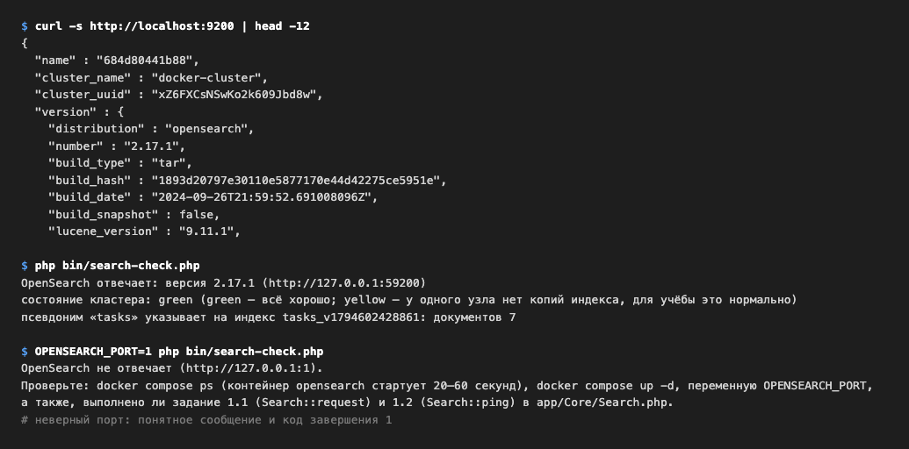

| Поле | Тип | Анализатор | Зачем |
|------|-----|-----------|-------|
| `id` | integer | — | номер задачи; по нему упорядочиваются результаты с одинаковой оценкой |
| `title` | text + подполе `title.raw` (keyword) | `russian` | главное поле поиска; `raw` нужен для сортировки по названию |
| `description` | text | `russian` | поиск по описанию |
| `project_title` | text | `russian` | задачу можно найти по названию её проекта |
| `project_id` | integer | — | фильтр «только этот проект» |
| `status`, `priority` | keyword | — | значение целиком: по нему фильтруют, а не ищут по словам |
| `due_date` | date (`yyyy-MM-dd`) | — | срок |
| `created_at` | date | — | время создания |

Решения: текстовые поля получают анализатор `russian`, который сводит слова к основе и отбрасывает служебные слова; значения для фильтров (`status`, `priority`) хранятся как `keyword`, иначе фильтр `term` не сработает; настройки `number_of_shards = 1`, `number_of_replicas = 0`, потому что узел один. Проверка анализатора:

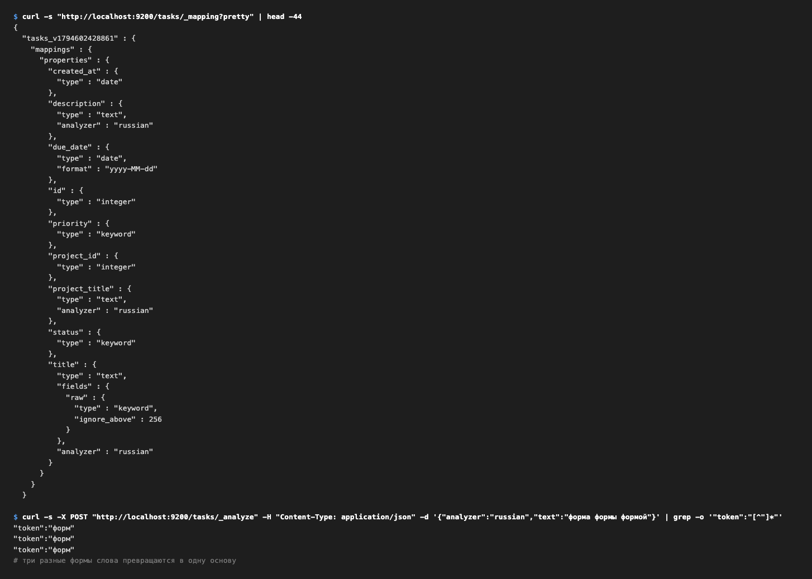

Три разные формы слова превращаются в одну основу, поэтому «форма» находит «форму». Подробнее — в [docs/search.md](./docs/search.md).

---

## Описание процесса индексации данных

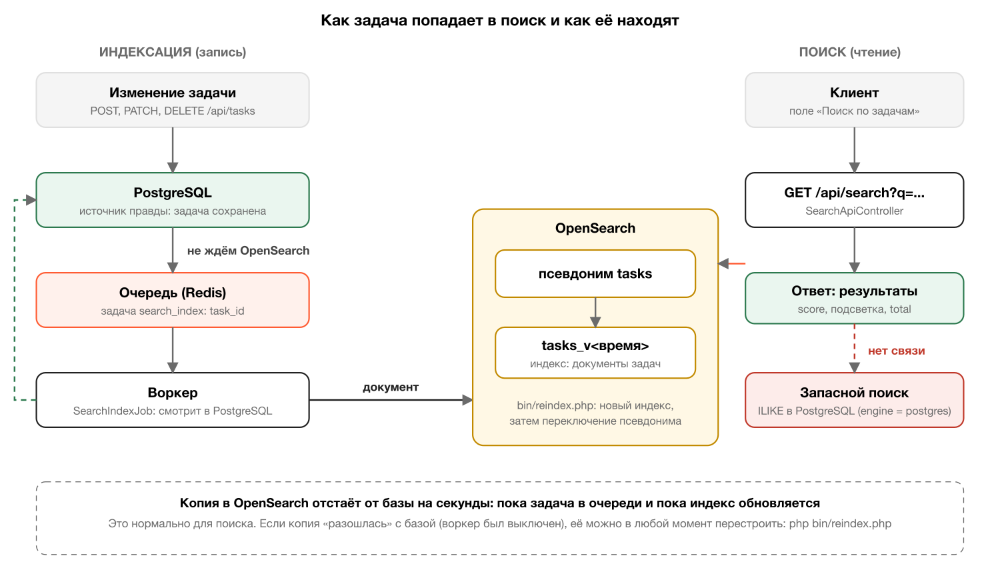

**PostgreSQL остаётся источником правды**, OpenSearch хранит копию, которую в любой момент можно перестроить. Копия создаётся двумя способами.

**1. Полная переиндексация** (`php bin/reindex.php`, метод `Search::reindexAll`): создаётся новый индекс `tasks_v<время>`, задачи читаются из PostgreSQL пачками по 500 штук (с названием проекта) и загружаются одним запросом `_bulk` (формат NDJSON), затем псевдоним `tasks` переключается на новый индекс одной неделимой операцией, а старые (и «осиротевшие» после сбоев) индексы удаляются. Пока идёт загрузка, поиск работает по старому индексу. На время загрузки автоматическое обновление индекса отключается (так быстрее и экономнее по памяти). Повторный запуск оставляет один индекс.

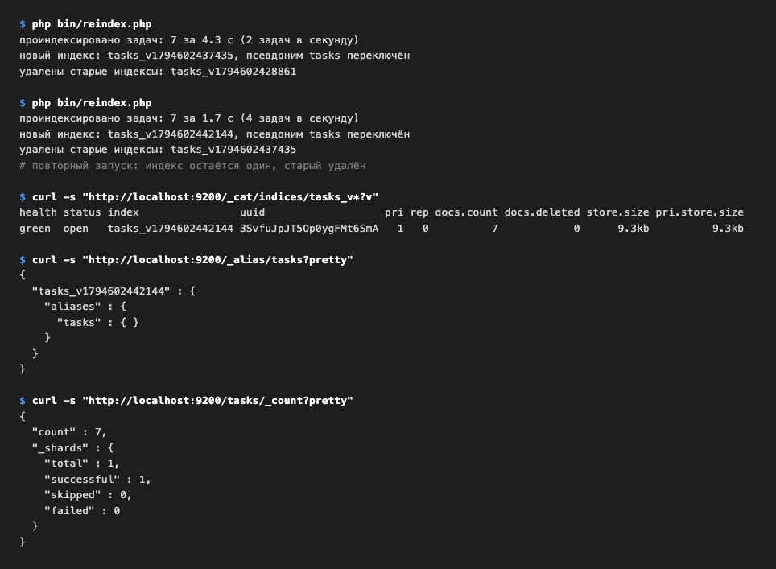

**2. Синхронизация при изменениях** (задача очереди `search_index`, класс `SearchIndexJob`): при создании, изменении и удалении задачи и при переименовании проекта контроллер ставит задачу в очередь из лабораторной работы №11 и сразу отвечает пользователю. Воркер **смотрит в PostgreSQL, какова задача сейчас**: есть — кладёт её свежую версию в индекс (`PUT /tasks/_doc/<номер>`), нет — удаляет документ (`DELETE`). При переименовании проекта обновляются документы всех его задач (`_bulk`). В задачу кладётся только `task_id` или `project_id`, а не данные: поэтому порядок задач не важен, повтор безопасен (идемпотентность), а индекс всегда получает самую свежую версию. Параметр `require_alias=true` запрещает молча создавать индекс со случайной структурой, если псевдонима ещё нет.

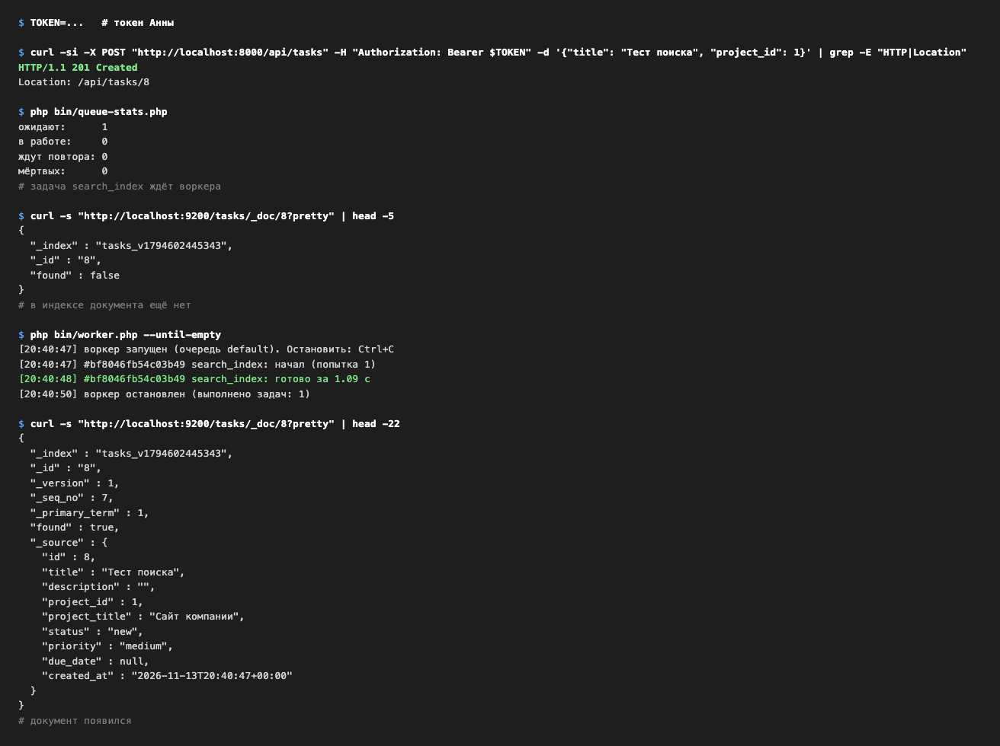

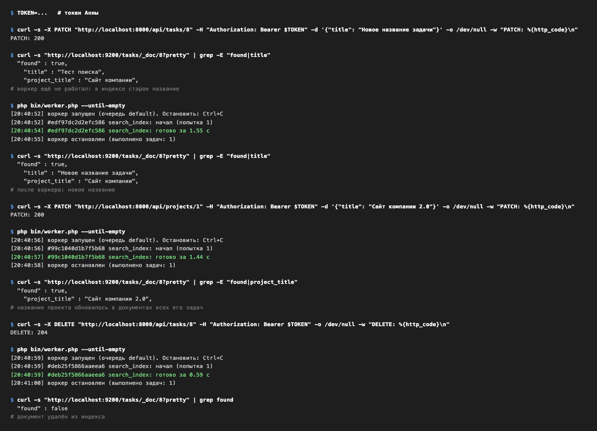

**Согласованность в конечном счёте.** Между изменением в базе и появлением изменения в поиске проходит время: пока задача лежит в очереди (на скриншоте воркер ещё не работал, и в индексе старое название) и пока OpenSearch обновляет индекс. Для поиска это нормально. Если копия разошлась с базой (воркер выключен, Redis был недоступен при постановке), её перестраивает `php bin/reindex.php`.

---

## Описание реализации полнотекстового поиска

**Запрос** (`Search::search`): `multi_match` по полям `title^3`, `project_title^2`, `description` с `fuzziness: AUTO` (прощает 1–2 опечатки в слове), фильтры `term` по `status` и `project_id` в блоке `bool.filter` (они только отсеивают и не влияют на оценку), страницы `from`/`size`, точное число найденных (`track_total_hits`), сортировка по оценке релевантности и по номеру при равенстве, подсветка найденных слов тегом `<mark>`. В подсветке включён `encoder: html`: HTML внутри текста задачи экранируется, поэтому название вида `<script>...` не попадёт на страницу как код (проверено автотестом).

**Обработчик** `GET /api/search` (`SearchApiController`): пустой запрос — 422; неверный статус — 422; в ответе `query`, `engine`, `total`, `took_ms`, `message` и `results` (поля задачи, `score`, `highlight`); заголовки `X-Total-Count` и `X-Search-Engine`. Если ничего не найдено, ответ 200 с пустым списком и сообщением, а не ошибка. Параметр `limit` ограничен 100.

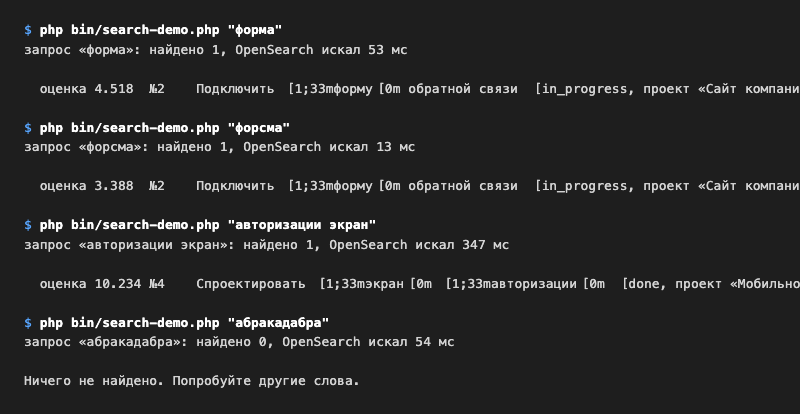

Слово «форма» находит задачу со словом «форму»; опечатка «форсма» — ту же задачу; слова в другом порядке («авторизации экран») находят «Спроектировать экран авторизации»; слово «портал» — задачу по названию проекта «Внутренний портал».

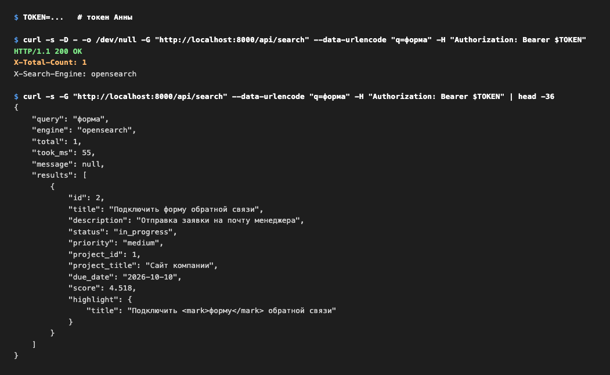

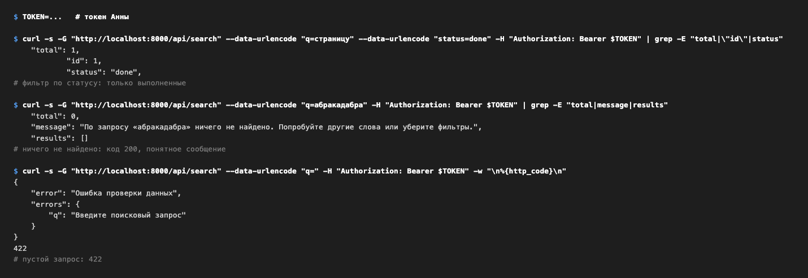

**В клиенте** добавлен блок «Поиск по задачам»: найденные слова выделены, показаны проект, статус, число найденного, время и какой поиск отвечал.


**Запасной поиск.** Если OpenSearch недоступен (исключение 503 из `Search::request`), обработчик выполняет поиск в PostgreSQL (`ILIKE` по названию): ответ того же вида, но `engine: postgres`. Ошибки другого рода (неверный запрос, ошибка кода) не прячутся. Для проверок есть заголовок `X-Search-Mode: postgres`, принудительно включающий запасной режим (работает при `debug = true`). Запасной поиск проще: слово «форма» он не находит.

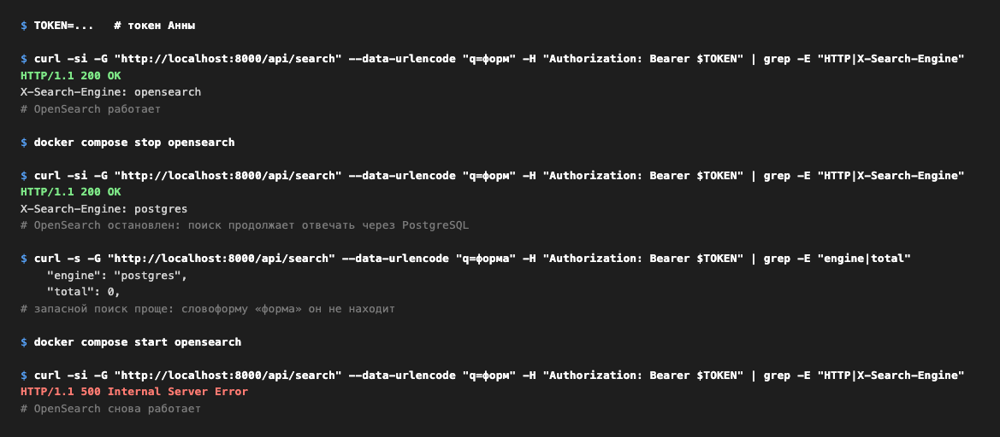

**Журнал поиска.** Каждый запрос записывается в журнал событий (тип `search`, категория `search`): текст запроса (обрезается до 200 символов), число найденного, время, поисковая система.

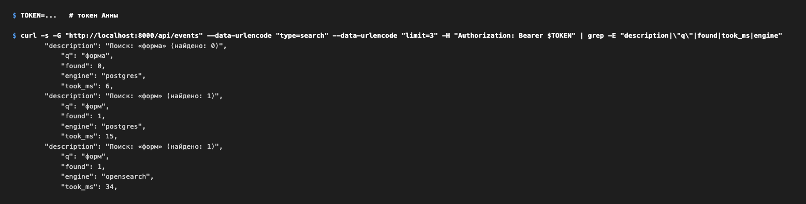

---

## Проверка работы поиска

**Качество.** Контрольные запросы на данных из `sql/seed.sql` (7 задач). `bin/search-compare.php` показывает, сколько находит каждый способ (время на таких объёмах несущественно):

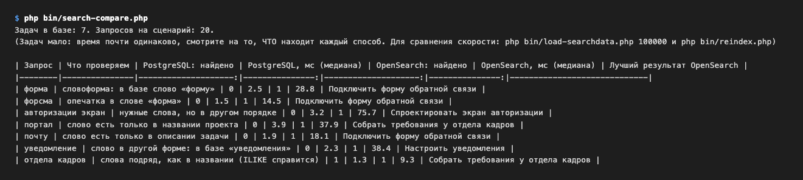

| Запрос | Что проверяем | `ILIKE`: найдено | OpenSearch: найдено |
|--------|---------------|-----------------:|--------------------:|
| форма | слово в другой форме («форму» в базе) | 0 | 1 |
| форсма | опечатка | 0 | 1 |
| авторизации экран | слова в другом порядке | 0 | 1 |
| портал | слово только в названии проекта | 0 | 1 |
| почту | слово только в описании | 0 | 1 |
| уведомление | другая форма слова («уведомления» в базе) | 0 | 1 |
| отдела кадров | слова подряд, как в названии | 1 | 1 |

`ILIKE` справился только там, где запрос совпал с названием символ в символ; OpenSearch нашёл всё.

**Скорость.** Загружено 20 007 задач со «живыми» названиями и описаниями (`php bin/load-searchdata.php 20000`), индекс перестроен за 11,9 с (около 1700 задач в секунду):

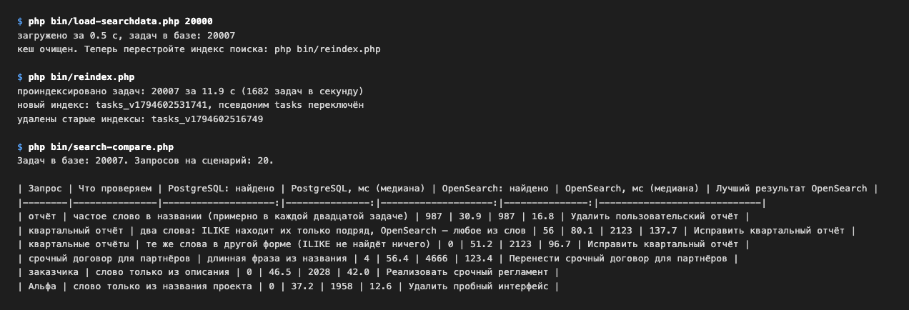

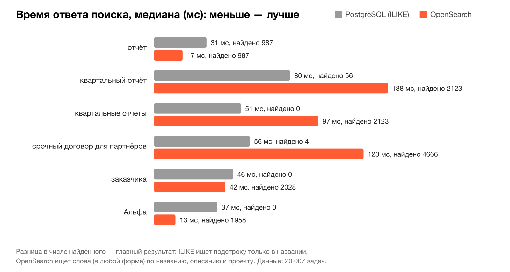

| Запрос | `ILIKE`: найдено | `ILIKE`, мс | OpenSearch: найдено | OpenSearch, мс |
|--------|-----------------:|------------:|--------------------:|---------------:|
| отчёт | 987 | 31 | 987 | 17 |
| квартальный отчёт | 56 | 80 | 2123 | 138 |
| квартальные отчёты | 0 | 51 | 2123 | 97 |
| срочный договор для партнёров | 4 | 56 | 4666 | 123 |
| заказчика | 0 | 47 | 2028 | 42 |
| Альфа | 0 | 37 | 1958 | 13 |

Время — медиана по 20 запросам. **Анализ.** (1) По времени явного победителя нет: на 20 тысячах задач `ILIKE` по одному полю отвечает за десятки миллисекунд. Для одного частого слова и для слов из описания и названия проекта OpenSearch быстрее или равен, а для запросов из нескольких слов он медленнее: он оценивает тысячи подходящих документов (по умолчанию подходит любое слово), а `ILIKE` ищет точную фразу и находит единицы. (2) Главное отличие в **числе и качестве найденного**: для «квартальные отчёты», «заказчика» и «Альфа» `ILIKE` не находит ничего. (3) Больше найденных — не всегда лучше: запрос «срочный договор для партнёров» нашёл 4666 задач, где совпало хотя бы одно слово; полезно, что лучшие совпадения идут первыми, но строгий поиск потребовал бы оператора «и». (4) Измерения проведены на ограниченном стенде (Docker с 4 ГБ памяти, 2 процессора, на нём работали другие контейнеры, OpenSearch с кучей 128 МБ), поэтому абсолютные числа нестабильны; на 100 000 задач этот стенд подвисал, поэтому приведены цифры для 20 007. Выводы о тенденциях (OpenSearch не быстрее `ILIKE` на таких объёмах, но находит принципиально больше) устойчивы.

---

## Тестирование

```bash
php tests/api-tests.php
```

Разделы 18–21 проверяют поиск (нужен запущенный OpenSearch; если его нет, тест сообщит об этом прямо). Раздел 18: связь, переиндексация (дважды: остаётся один индекс), структура индекса, анализатор `russian`, `bulk` сообщает об ошибке. Раздел 19: после создания, изменения, переименования проекта, удаления задача сначала ждёт воркера, затем индекс меняется; повторные задачи не создают дублей; режим `sync`; задача для несуществующей задачи не ломает воркер. Раздел 20: 401 без токена; 422; «форма» находит «форму»; опечатка; порядок слов; поле проекта; поле описания; пустой результат; фильтры; страницы; ранжирование (слово в названии выше слова в описании); экранирование подсветки; спецсимволы; журнал поиска; запасной режим. Раздел 21: свои проверки.

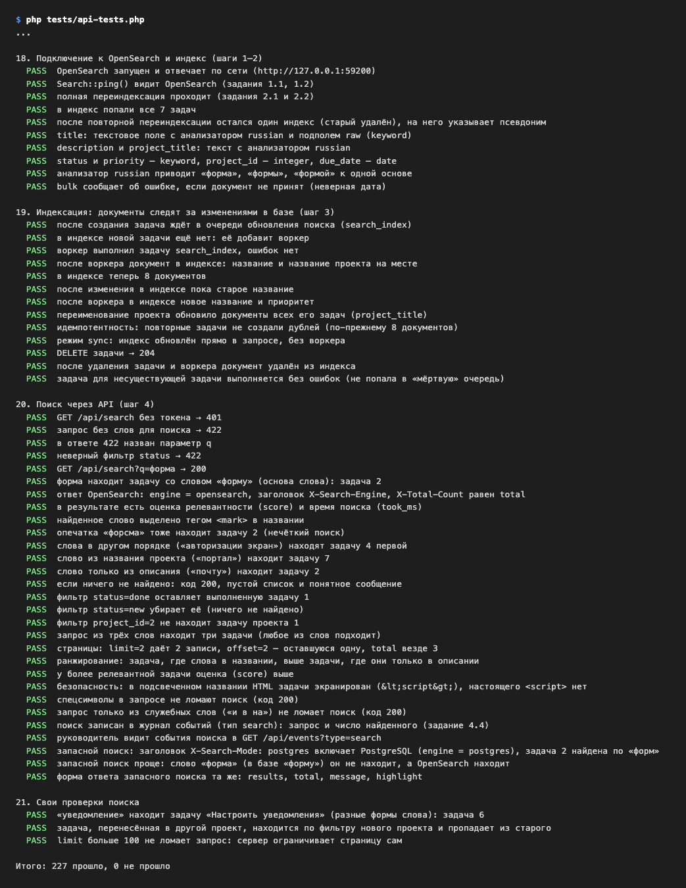

Старые проверки лабораторной работы №11, считавшие задачи в очереди, теперь считают задачи по типу (`queued('notification')`): после подключения поиска при каждом изменении задачи в очереди появляется ещё и `search_index`.

Подробнее — в [docs/search.md](./docs/search.md).

---

## Вывод

Подключён OpenSearch, создан индекс с русским анализатором (текстовые поля для поиска, `keyword` для фильтров, псевдоним для безостановочной переиндексации), реализованы полная переиндексация пачками и синхронизация при изменениях через очередь (идемпотентно, по текущему состоянию PostgreSQL), а также полнотекстовый поиск с весами полей, опечатками, фильтрами, страницами, безопасной подсветкой и запасным режимом на PostgreSQL. Автотесты (227 проверок) подтверждают работу индексации и поиска.

Что показала работа: полнотекстовый поиск нужен не для скорости, а для качества: он находит слова в любой форме, прощает опечатки, ищет по нескольким полям и ставит лучшее первым, а `ILIKE` на тех же данных находил только точные совпадения. Платой стали ещё один сервер, копия данных, которая отстаёт от базы на секунды, и необходимость продумать сбои: поэтому PostgreSQL остаётся источником правды, а поиск при недоступности OpenSearch переходит на запасной вариант.
