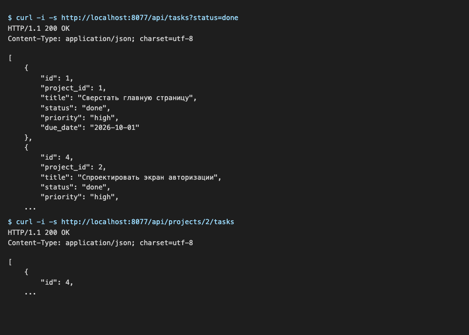
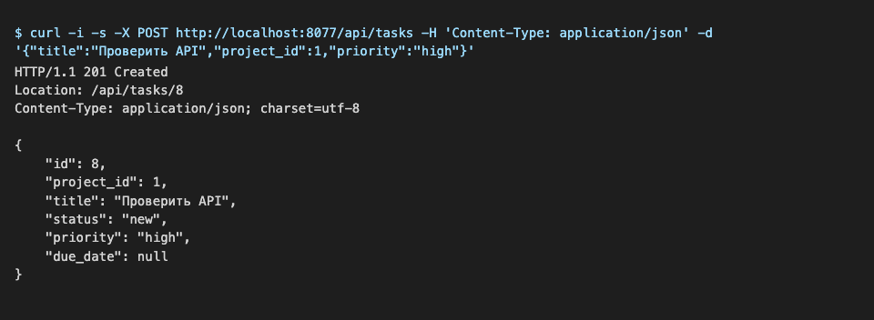
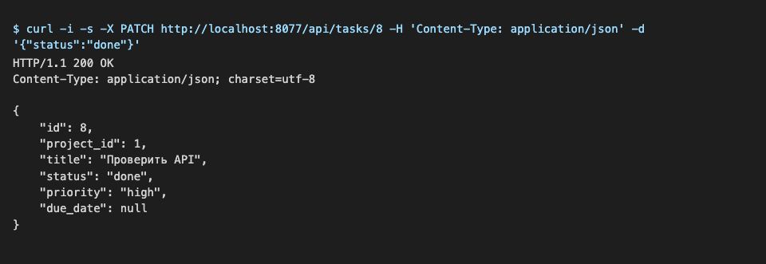
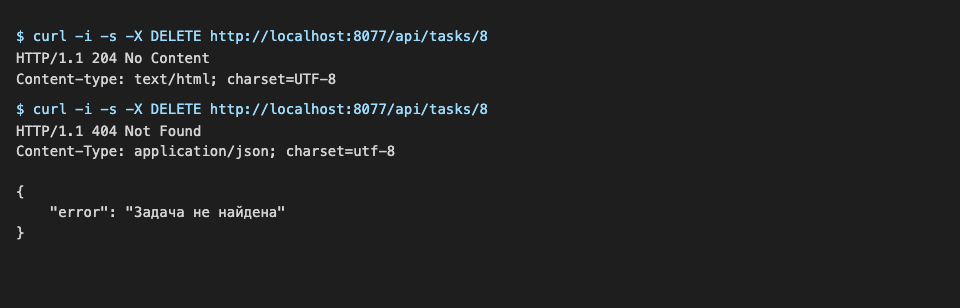
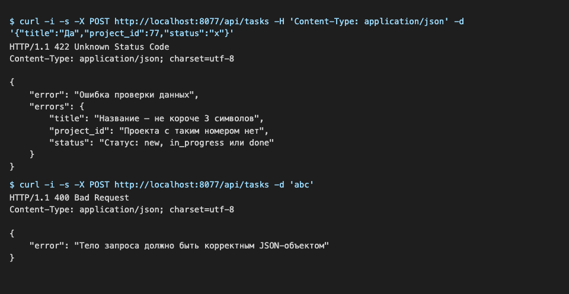
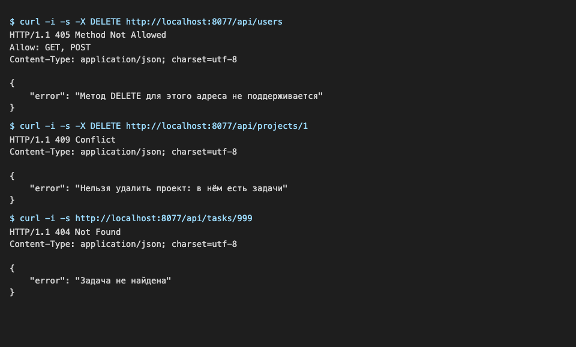

# Лабораторная работа №7
## Проектирование REST API

### Цель работы

Изучить принципы проектирования REST API, разработать набор ресурсов информационной системы, реализовать основные HTTP-методы, подготовить документацию API и выполнить тестирование запросов.

---

## Краткое описание выполненного задания

На основе серверной части из лабораторной работы №6 («Система управления задачами команды», PHP 8.2, MVC) реализован REST API с тремя ресурсами: задачи, проекты, участники. Для каждого ресурса поддержаны операции CRUD через методы `GET`, `POST`, `PUT`/`PATCH`, `DELETE`; ответы возвращаются в формате JSON с корректными кодами состояния (200, 201, 204, 400, 404, 405, 409, 422, 500). Сайт из лабораторной работы №6 продолжает работать.

## Предметная область

Демонстрационный вариант 0: «Система управления задачами команды» (в вашей работе здесь заполненная карточка вашей предметной области и 2–3 предложения о переносе: что изменили и как проверили).

| Что определить | Значение |
|----------------|----------|
| Основная сущность | задача (`task`, `tasks`) |
| Связанная сущность | проект (`project`, `projects`) |
| Третья сущность | участник (`user`, `users`) |
| Поля основной сущности | `id`, `project_id`, `title`, `status` (`new`, `in_progress`, `done`), `priority`, `due_date` |
| Поля третьей сущности | `id`, `name`, `email`, `role` |

---

**Запуск:**

```bash
cd lab7/src
php -S localhost:8000 -t public
```

---

## Описание реализованных ресурсов

| Ресурс | URL | Методы | Назначение | Формат данных |
|--------|-----|--------|------------|---------------|
| Задачи | `/api/tasks`, `/api/tasks/{id}` | GET, POST, PUT/PATCH, DELETE | учёт задач команды | `id, project_id, title, status, priority, due_date` |
| Проекты | `/api/projects`, `/api/projects/{id}`, `/api/projects/{id}/tasks` | GET, POST, PUT/PATCH, DELETE | проекты и их задачи | `id, title, description` |
| Участники | `/api/users`, `/api/users/{id}` | GET, POST, PUT/PATCH, DELETE | состав команды | `id, name, email, role` |

Адреса — существительные во множественном числе; действие определяется HTTP-методом; связь «проект — его задачи» выражена вложенным адресом; фильтры передаются строкой запроса (`?status=done&project_id=1`).

## Описание REST API

Полная документация с параметрами, примерами запросов и ответов: [docs/api.md](./docs/api.md). Сводная таблица:

| Метод | URL | Назначение | Успешный код |
|-------|-----|------------|--------------|
| GET | `/api/tasks` | список задач (`status`, `project_id`) | 200 |
| GET | `/api/tasks/{id}` | задача по номеру | 200 |
| POST | `/api/tasks` | создать задачу | 201 |
| PUT, PATCH | `/api/tasks/{id}` | изменить задачу | 200 |
| DELETE | `/api/tasks/{id}` | удалить задачу | 204 |
| GET, POST | `/api/projects` | список / создание проекта | 200 / 201 |
| GET, PUT, PATCH, DELETE | `/api/projects/{id}` | проект: чтение, изменение, удаление (409, если есть задачи) | 200 / 204 |
| GET | `/api/projects/{id}/tasks` | задачи проекта | 200 |
| GET, POST | `/api/users` | список / создание участника | 200 / 201 |
| GET, PUT, PATCH, DELETE | `/api/users/{id}` | участник: чтение, изменение, удаление | 200 / 204 |

Устройство реализации:
- маршруты `routes/web.php`; маршрутизатор `Router` поддерживает `get, post, put, patch, delete` и сам возвращает JSON-ответы 404 и 405 (с заголовком `Allow`) для адресов `/api/...`;
- контроллеры `app/Controllers/Api/`: по пять методов `index, show, store, update, destroy`; `PUT` и `PATCH` обрабатываются одним методом `update` (присланные поля заменяют старые);
- модели наследуют от `JsonRepository` (`all, find, add, update, delete`), данные в `storage/*.json`;
- помощники `json_response()`, `json_error()`, `no_content()`, `json_input()` в `app/helpers.php`;
- данные проверяются на сервере (`validate()`), ошибки возвращаются все сразу в формате `{"error": "...", "errors": {"поле": "..."}}`.

## Примеры запросов и ответов

**Создание задачи** (`POST /api/tasks`):
```http
POST /api/tasks
Content-Type: application/json

{ "title": "Проверить API", "project_id": 1, "priority": "high" }
```
```http
HTTP/1.1 201 Created
Location: /api/tasks/8

{ "id": 8, "project_id": 1, "title": "Проверить API", "status": "new", "priority": "high", "due_date": null }
```

**Ошибка проверки** (`POST /api/tasks` с телом `{"title":"Да","project_id":77,"status":"x"}`), код 422:
```json
{
    "error": "Ошибка проверки данных",
    "errors": {
        "title": "Название — не короче 3 символов",
        "project_id": "Проекта с таким номером нет",
        "status": "Статус: new, in_progress или done"
    }
}
```

**Изменение** (`PATCH /api/tasks/8`, тело `{"status": "done"}`): код 200, меняется только статус.
**Удаление** (`DELETE /api/tasks/8`): код 204, тела нет; повторное удаление — 404.
**Метод не поддержан** (`DELETE /api/users`): код 405, `Allow: GET, POST`.
**Конфликт** (`DELETE /api/projects/1`, в проекте есть задачи): код 409.

### Тестирование

Выполнено 28 запросов (успешные и ошибочные, по всем трём ресурсам), результаты — в [docs/testing.md](./docs/testing.md). Во всех строках получен ожидаемый код.

#### GET: список с фильтром и задачи проекта


#### POST: создание (201, Location)


#### PATCH: изменение


#### DELETE: 204 и повторное удаление (404)


#### Ошибки 422 и 400


#### Ошибки 405, 409, 404


---

## Вывод

В результате работы спроектированы три ресурса информационной системы и реализован REST API на PHP: адреса строятся по правилам REST, действия задаются HTTP-методами, поддерживаются все операции CRUD, данные передаются в JSON, а результат сообщается кодами состояния 200, 201, 204, 400, 404, 405, 409 и 422. Серверная проверка входных данных и единый формат ошибок облегчают работу клиентского приложения, а документация (`docs/api.md`) и таблица тестирования (`docs/testing.md`) позволяют воспроизвести и проверить каждый запрос. Структура «маршрут — контроллер — модель» из лабораторной работы №6 позволяет заменить файловое хранилище базой данных, не меняя контроллеры.

---

**Структура репозитория:**
```
lab7/
├── README.md
├── src/          # исходный код (сайт из лабораторной работы №6 + REST API)
├── images/       # скриншоты тестирования (6 файлов)
└── docs/
    ├── api.md        # документация API
    └── testing.md    # результаты тестирования
```
