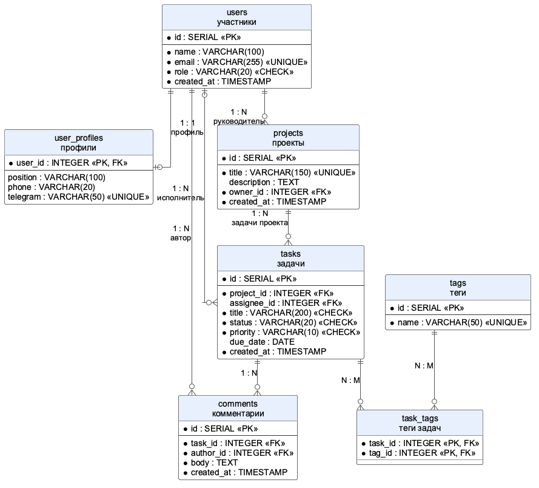
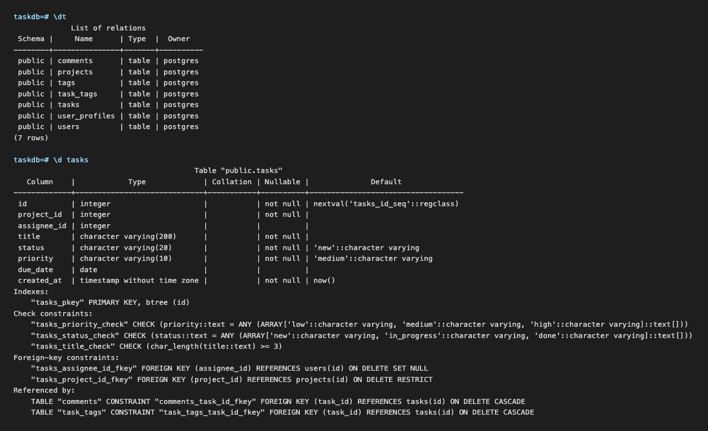
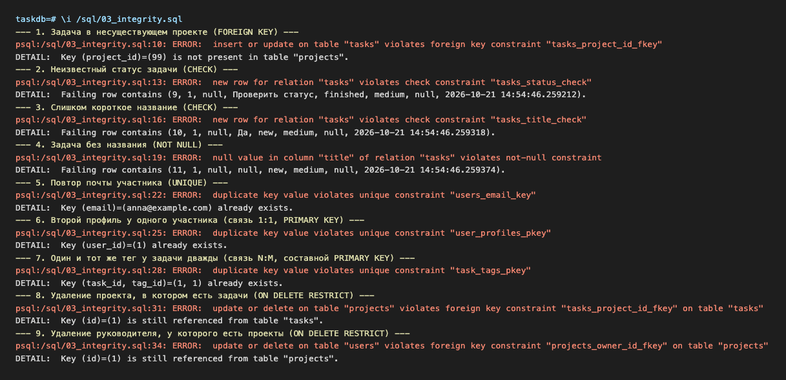
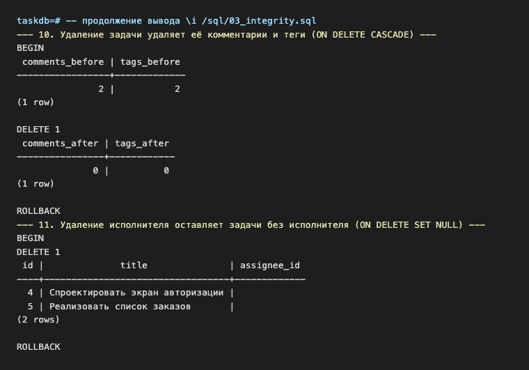
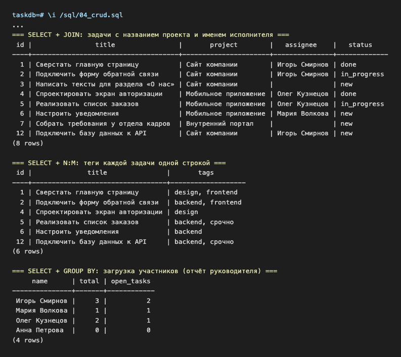
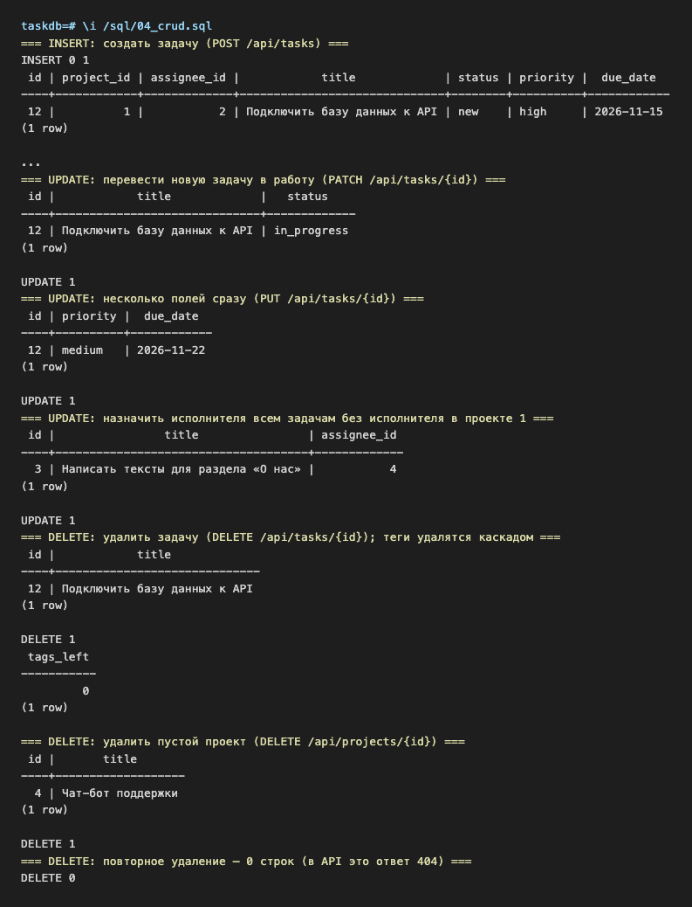
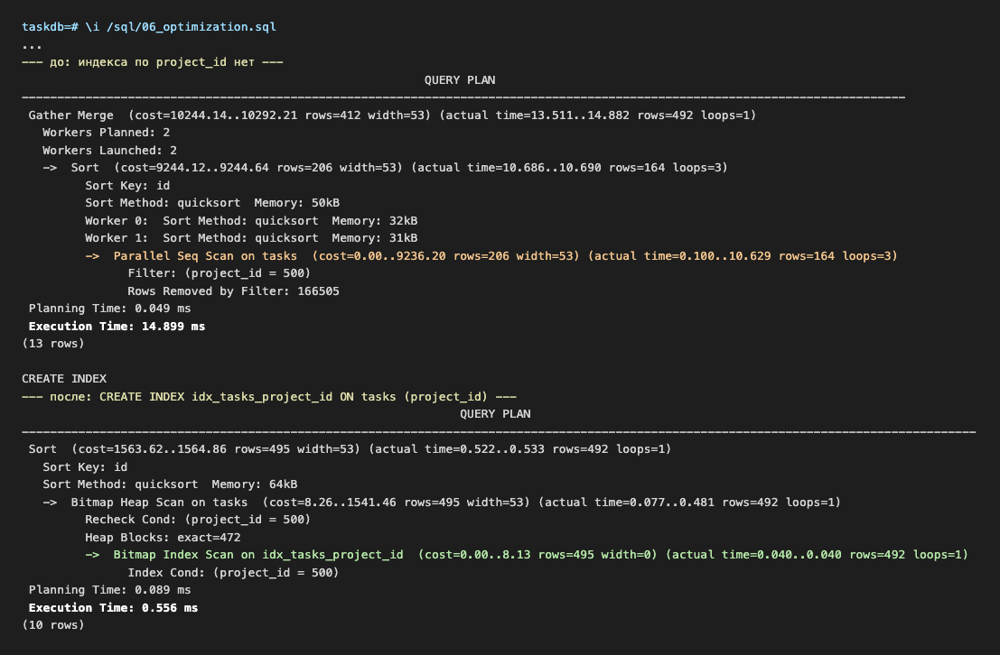
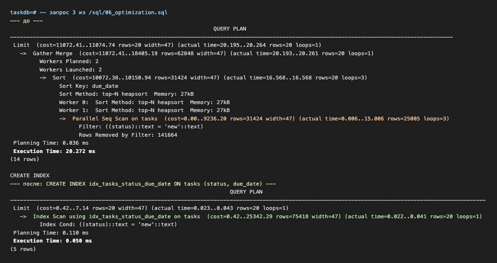
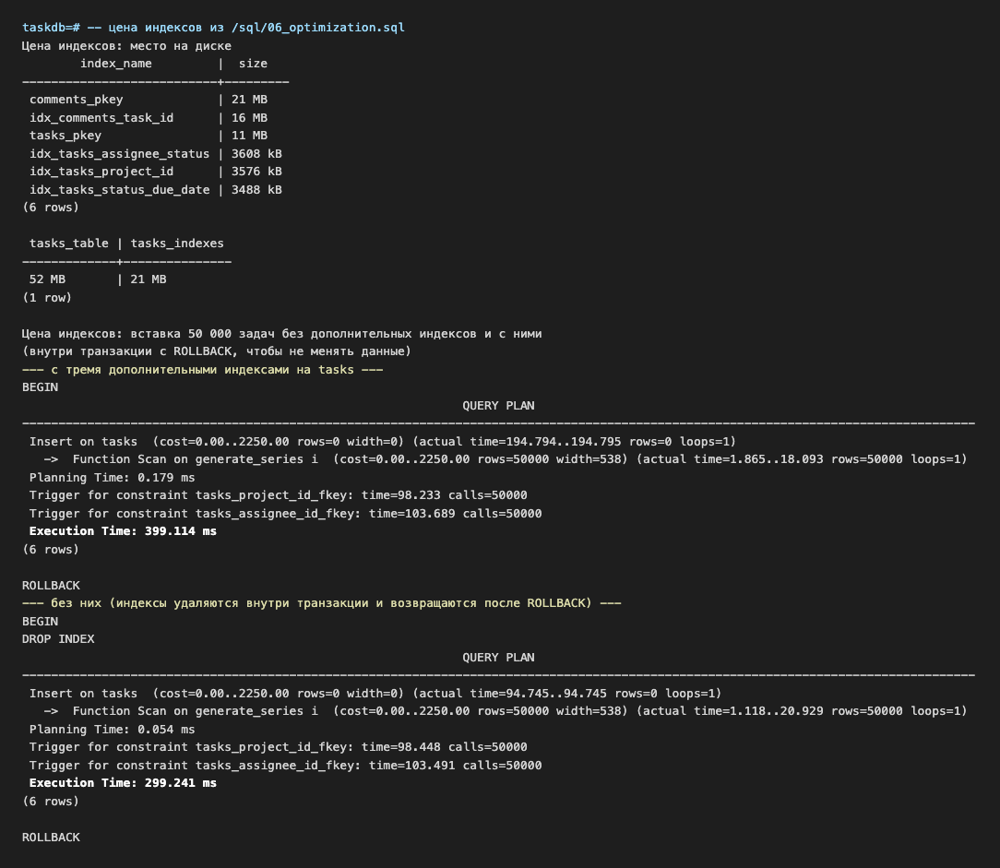

# Лабораторная работа №8
## Проектирование и реализация базы данных

### Цель работы

Изучить основы проектирования реляционных баз данных, разработать структуру базы данных PostgreSQL, реализовать связи между сущностями, выполнить основные операции по работе с данными и освоить базовые методы оптимизации SQL-запросов.

---

## Краткое описание выполненного задания

Для системы «Система управления задачами команды» (лабораторные работы №1–7) спроектирована и реализована база данных PostgreSQL 16: 7 таблиц, связи «один к одному», «один ко многим» и «многие ко многим», ограничения целостности (`PRIMARY KEY`, `FOREIGN KEY`, `NOT NULL`, `UNIQUE`, `CHECK`, `DEFAULT`). Подготовлены SQL-скрипты создания таблиц, тестовых данных, проверки ссылочной целостности и CRUD-операций. На 500 000 задач и 1 000 000 комментариев проанализированы планы четырёх частых запросов (`EXPLAIN ANALYZE`); после добавления индексов они ускорились в 20–400 раз.

## Предметная область

Демонстрационный вариант 0: «Система управления задачами команды» (в вашей работе здесь карточка вашей предметной области).

| Что определить | Значение |
|----------------|----------|
| Основная сущность | задача (`tasks`) |
| Связанная сущность | проект (`projects`) |
| Третья сущность | участник (`users`) |
| Дополнительные сущности | профиль участника (`user_profiles`), комментарий (`comments`), тег (`tags`) |
| Связь 1:1 | участник — профиль |
| Связи 1:N | проект — задачи, участник — задачи, участник — проекты, задача — комментарии |
| Связь N:M | задачи — теги (через `task_tags`) |

Таблицы `tasks`, `projects` и `users` повторяют ресурсы REST API из лабораторной работы №7 (те же поля и исходные данные), поэтому в следующей работе API можно перевести с JSON-файлов на базу, не меняя формат ответов.

---

**Запуск** (нужен Docker; без него — установленный PostgreSQL 16 и клиент psql, pgAdmin или DBeaver):

```bash
cd lab8
docker compose up -d                                  # сервер PostgreSQL 16, база taskdb
docker compose exec db psql -U postgres -d taskdb    # консоль psql
```

Внутри `psql` скрипты выполняются по порядку:

```sql
\i /sql/01_schema.sql        -- таблицы и ограничения
\i /sql/02_seed.sql          -- исходные данные
\i /sql/03_integrity.sql     -- проверка ограничений и связей
\i /sql/04_crud.sql          -- CRUD-операции
\i /sql/05_test_data.sql     -- 500 000 задач для проверки производительности
\i /sql/06_optimization.sql  -- EXPLAIN ANALYZE до и после индексов
```

Параметры подключения для pgAdmin/DBeaver: хост `localhost`, порт `5432`, база `taskdb`, пользователь `postgres`, пароль `secret`.

---

## Структура базы данных

### ER-диаграмма



**Исходник:** [`diagrams/src/er.puml`](./diagrams/src/er.puml)

### Таблицы

Полный SQL: [`sql/01_schema.sql`](./sql/01_schema.sql).

**users** — участники команды

| Поле | Тип | Ограничения | Описание |
|------|-----|-------------|----------|
| `id` | `SERIAL` | `PRIMARY KEY` | номер участника |
| `name` | `VARCHAR(100)` | `NOT NULL` | имя |
| `email` | `VARCHAR(255)` | `NOT NULL`, `UNIQUE` | почта, не повторяется |
| `role` | `VARCHAR(20)` | `NOT NULL`, `DEFAULT 'developer'`, `CHECK` | `manager`, `developer`, `tester` |
| `created_at` | `TIMESTAMP` | `NOT NULL`, `DEFAULT NOW()` | дата регистрации |

**user_profiles** — профиль участника (связь 1:1)

| Поле | Тип | Ограничения | Описание |
|------|-----|-------------|----------|
| `user_id` | `INTEGER` | `PRIMARY KEY`, `REFERENCES users ON DELETE CASCADE` | участник; одновременно первичный и внешний ключ |
| `position` | `VARCHAR(100)` | | должность |
| `phone` | `VARCHAR(20)` | | телефон |
| `telegram` | `VARCHAR(50)` | `UNIQUE` | ник в Telegram |

**projects** — проекты

| Поле | Тип | Ограничения | Описание |
|------|-----|-------------|----------|
| `id` | `SERIAL` | `PRIMARY KEY` | номер проекта |
| `title` | `VARCHAR(150)` | `NOT NULL`, `UNIQUE` | название |
| `description` | `TEXT` | | описание |
| `owner_id` | `INTEGER` | `NOT NULL`, `REFERENCES users ON DELETE RESTRICT` | руководитель |
| `created_at` | `TIMESTAMP` | `NOT NULL`, `DEFAULT NOW()` | дата создания |

**tasks** — задачи (основная сущность)

| Поле | Тип | Ограничения | Описание |
|------|-----|-------------|----------|
| `id` | `SERIAL` | `PRIMARY KEY` | номер задачи |
| `project_id` | `INTEGER` | `NOT NULL`, `REFERENCES projects ON DELETE RESTRICT` | проект |
| `assignee_id` | `INTEGER` | `REFERENCES users ON DELETE SET NULL` | исполнитель, может отсутствовать |
| `title` | `VARCHAR(200)` | `NOT NULL`, `CHECK (char_length(title) >= 3)` | название, не короче 3 символов (как в API) |
| `status` | `VARCHAR(20)` | `NOT NULL`, `DEFAULT 'new'`, `CHECK` | `new`, `in_progress`, `done` |
| `priority` | `VARCHAR(10)` | `NOT NULL`, `DEFAULT 'medium'`, `CHECK` | `low`, `medium`, `high` |
| `due_date` | `DATE` | | срок выполнения |
| `created_at` | `TIMESTAMP` | `NOT NULL`, `DEFAULT NOW()` | дата создания |

**comments** — комментарии к задачам

| Поле | Тип | Ограничения | Описание |
|------|-----|-------------|----------|
| `id` | `SERIAL` | `PRIMARY KEY` | номер комментария |
| `task_id` | `INTEGER` | `NOT NULL`, `REFERENCES tasks ON DELETE CASCADE` | задача |
| `author_id` | `INTEGER` | `NOT NULL`, `REFERENCES users ON DELETE RESTRICT` | автор |
| `body` | `TEXT` | `NOT NULL`, `CHECK (char_length(body) > 0)` | текст |
| `created_at` | `TIMESTAMP` | `NOT NULL`, `DEFAULT NOW()` | дата |

**tags** и **task_tags** — теги и связь «задача — тег» (N:M)

| Таблица | Поле | Тип | Ограничения |
|---------|------|-----|-------------|
| `tags` | `id` | `SERIAL` | `PRIMARY KEY` |
| `tags` | `name` | `VARCHAR(50)` | `NOT NULL`, `UNIQUE` |
| `task_tags` | `task_id` | `INTEGER` | `REFERENCES tasks ON DELETE CASCADE` |
| `task_tags` | `tag_id` | `INTEGER` | `REFERENCES tags ON DELETE CASCADE` |
| `task_tags` | | | `PRIMARY KEY (task_id, tag_id)` — пара не повторяется |

Структура соответствует трём правилам нормализации: в каждой ячейке одно значение (теги вынесены в отдельную таблицу, а не записаны через запятую), каждая таблица описывает одну сущность, данные участника хранятся один раз в `users`, а в задачах и комментариях только ссылка на него.



---

## Связи между сущностями

| Связь | Тип | Как реализована | При удалении «главной» строки |
|-------|-----|-----------------|-------------------------------|
| участник — профиль | 1:1 | `user_profiles.user_id` — первичный и внешний ключ одновременно | профиль удаляется (`CASCADE`) |
| участник — проекты | 1:N | `projects.owner_id` | запрет, пока у руководителя есть проекты (`RESTRICT`) |
| проект — задачи | 1:N | `tasks.project_id` | запрет, пока в проекте есть задачи (`RESTRICT`); в API это ответ 409 |
| участник — задачи | 1:N | `tasks.assignee_id`, может быть `NULL` | задачи остаются без исполнителя (`SET NULL`) |
| задача — комментарии | 1:N | `comments.task_id` | комментарии удаляются (`CASCADE`) |
| участник — комментарии | 1:N | `comments.author_id` | запрет (`RESTRICT`): история обсуждения не теряется |
| задачи — теги | N:M | связующая таблица `task_tags` с составным первичным ключом | строки связи удаляются (`CASCADE`) |

### Проверка ссылочной целостности

Скрипт [`sql/03_integrity.sql`](./sql/03_integrity.sql) пытается нарушить каждое правило. Все 9 некорректных запросов отклонены базой, а каскадное удаление и `SET NULL` сработали как задумано (проверки выполнены внутри транзакции с `ROLLBACK`, данные не изменились).

| № | Что пытаемся сделать | Ответ PostgreSQL |
|---|----------------------|------------------|
| 1 | задача в проекте №99 | `violates foreign key constraint "tasks_project_id_fkey"` |
| 2 | статус `finished` | `violates check constraint "tasks_status_check"` |
| 3 | название «Да» | `violates check constraint "tasks_title_check"` |
| 4 | задача без названия | `null value in column "title" ... violates not-null constraint` |
| 5 | вторая `anna@example.com` | `duplicate key value violates unique constraint "users_email_key"` |
| 6 | второй профиль участника №1 | `duplicate key value violates unique constraint "user_profiles_pkey"` |
| 7 | тег `frontend` у задачи №1 повторно | `duplicate key value violates unique constraint "task_tags_pkey"` |
| 8 | удалить проект №1 с задачами | `violates foreign key constraint "tasks_project_id_fkey"` |
| 9 | удалить руководителя Анну | `violates foreign key constraint "projects_owner_id_fkey"` |
| 10 | удалить задачу №2 | 2 комментария и 2 тега удалились вместе с ней (`CASCADE`) |
| 11 | удалить участника №4 | у задач №4 и №5 `assignee_id` стал `NULL` (`SET NULL`) |





---

## Примеры SQL-запросов (CRUD)

Все запросы: [`sql/04_crud.sql`](./sql/04_crud.sql). Для каждого указан адрес REST API из лабораторной работы №7, который будет его выполнять.

| Операция | SQL | REST API |
|----------|-----|----------|
| Create | `INSERT INTO tasks (...) VALUES (...) RETURNING ...` | `POST /api/tasks` |
| Read (список) | `SELECT ... FROM tasks WHERE status = 'in_progress' ORDER BY due_date` | `GET /api/tasks?status=in_progress` |
| Read (одна) | `SELECT ... FROM tasks WHERE id = 5` | `GET /api/tasks/5` |
| Update | `UPDATE tasks SET status = 'in_progress' WHERE id = ... RETURNING ...` | `PATCH /api/tasks/{id}` |
| Delete | `DELETE FROM tasks WHERE id = ... RETURNING ...` | `DELETE /api/tasks/{id}` |

**Создание задачи.** `RETURNING` сразу возвращает созданную строку, а `\gset` сохраняет её номер в переменную psql `:task_id` для следующих запросов:

```sql
INSERT INTO tasks (project_id, assignee_id, title, priority, due_date)
VALUES (1, 2, 'Подключить базу данных к API', 'high', '2026-11-15')
RETURNING id AS task_id, title, status, priority, due_date \gset
```

Новая задача получила номер 12, а не 8: номера 8–11 израсходованы на четыре неудачные вставки из `03_integrity.sql`. Счётчик `SERIAL` не возвращает номера, даже если вставка закончилась ошибкой, и пропуски в `id` — это нормально.

**Задачи с проектом и исполнителем** (`LEFT JOIN`, потому что у части задач исполнителя нет):

```sql
SELECT t.id, t.title, p.title AS project, u.name AS assignee, t.status
FROM tasks t
JOIN projects p ON p.id = t.project_id
LEFT JOIN users u ON u.id = t.assignee_id
ORDER BY t.id;
```

**Теги задачи одной строкой** (связь N:M):

```sql
SELECT t.id, t.title, string_agg(g.name, ', ' ORDER BY g.name) AS tags
FROM tasks t
JOIN task_tags tt ON tt.task_id = t.id
JOIN tags g       ON g.id = tt.tag_id
GROUP BY t.id, t.title
ORDER BY t.id;
```

**Загрузка участников** (отчёт руководителя):

```sql
SELECT u.name,
       COUNT(t.id)                                   AS total,
       COUNT(t.id) FILTER (WHERE t.status <> 'done') AS open_tasks
FROM users u
LEFT JOIN tasks t ON t.assignee_id = u.id
GROUP BY u.id, u.name
ORDER BY open_tasks DESC, u.name;
```

**Изменение и удаление:**

```sql
UPDATE tasks SET status = 'in_progress' WHERE id = :task_id RETURNING id, title, status;
DELETE FROM tasks WHERE id = :task_id RETURNING id, title;   -- теги задачи удалятся каскадом
DELETE FROM tasks WHERE id = :task_id;                       -- DELETE 0: в API это ответ 404
```

#### SELECT: JOIN, теги (N:M), отчёт с GROUP BY


#### INSERT, UPDATE, DELETE


---

## Результаты оптимизации запросов

Для проверки скорости скрипт [`sql/05_test_data.sql`](./sql/05_test_data.sql) добавляет 1000 проектов, 200 участников, 500 000 задач и 1 000 000 комментариев. Затем [`sql/06_optimization.sql`](./sql/06_optimization.sql) для каждого частого запроса выполняет `EXPLAIN ANALYZE` без индекса, создаёт индекс и повторяет `EXPLAIN ANALYZE`. Полные планы и разбор: [`docs/optimization.md`](./docs/optimization.md).

| № | Запрос | Индекс | План до | План после | До, мс | После, мс | Ускорение |
|---|--------|--------|---------|------------|-------:|----------:|----------:|
| 1 | задачи проекта (`WHERE project_id = 500`) | `tasks (project_id)` | Parallel Seq Scan | Bitmap Index Scan | 14,9 | 0,56 | ×27 |
| 2 | мои задачи в работе (`assignee_id` + `status`) | `tasks (assignee_id, status)` | Parallel Seq Scan | Bitmap Index Scan | 16,1 | 0,82 | ×20 |
| 3 | 20 новых задач по сроку (`ORDER BY due_date LIMIT 20`) | `tasks (status, due_date)` | Seq Scan + Sort | Index Scan, без сортировки | 20,3 | 0,05 | ×405 |
| 4 | комментарии к задаче | `comments (task_id)` | Parallel Seq Scan | Index Scan | 42,0 | 0,13 | ×331 |

Наблюдения:

- PostgreSQL не создаёт индексы для внешних ключей автоматически, поэтому запросы 1 и 4 до оптимизации перебирали всю таблицу (в запросе 1 каждый из трёх параллельных процессов прочитал и отбросил около 166 тысяч строк, в запросе 4 — по 333 тысячи);
- в запросе 3 индекс `(status, due_date)` хранит строки уже отсортированными, и из плана исчез шаг `Sort`: база читает первые 20 записей и останавливается;
- индекс не помогает, если запрос читает большую часть таблицы (отчёт по всем проектам; условие `status = 'done'`, которому подходит 60% строк) или ищет подстроку `ILIKE '%...%'`: планировщик всё равно выбирает `Seq Scan`;
- у индексов есть цена: три новых индекса на `tasks` занимают по 3,5 МБ, а вставка 50 000 строк с ними заняла 194,8 мс против 94,7 мс без них.

#### Запрос 1 до и после индекса


#### Запрос 3 до и после индекса


#### Цена индексов


---

## Вывод

В результате работы спроектирована и реализована реляционная база данных PostgreSQL для системы управления задачами: 7 таблиц, связи всех трёх типов (1:1, 1:N и N:M) и ограничения целостности. Правила, которые в лабораторной работе №7 проверял PHP-код (допустимые статусы, длина названия, существование проекта, запрет удалить проект с задачами), теперь дополнительно проверяет сама база, и их невозможно обойти из любой программы: это подтверждено скриптом `03_integrity.sql`. CRUD-запросы соответствуют методам REST API и будут использованы при подключении базы к серверной части. Анализ планов `EXPLAIN ANALYZE` на 500 000 задач показал, что индексы на внешние ключи и на столбцы фильтрации и сортировки ускоряют частые запросы в 20–400 раз, но не помогают запросам, читающим большую часть таблицы, и замедляют запись, поэтому их нужно создавать осознанно и проверять планом выполнения.

---

**Структура репозитория:**
```
lab8/
├── README.md
├── docker-compose.yml        # PostgreSQL 16 для запуска скриптов
├── sql/
│   ├── 01_schema.sql         # создание таблиц и ограничений
│   ├── 02_seed.sql           # исходные данные
│   ├── 03_integrity.sql      # проверка ограничений и ссылочной целостности
│   ├── 04_crud.sql           # CRUD-операции
│   ├── 05_test_data.sql      # большой объём данных для оптимизации
│   └── 06_optimization.sql   # EXPLAIN ANALYZE до и после индексов
├── diagrams/
│   ├── images/er.png         # ER-диаграмма
│   └── src/er.puml           # исходник ER-диаграммы (PlantUML)
├── images/                   # скриншоты выполнения скриптов (8 файлов)
└── docs/
    └── optimization.md       # полные планы выполнения и разбор
```
