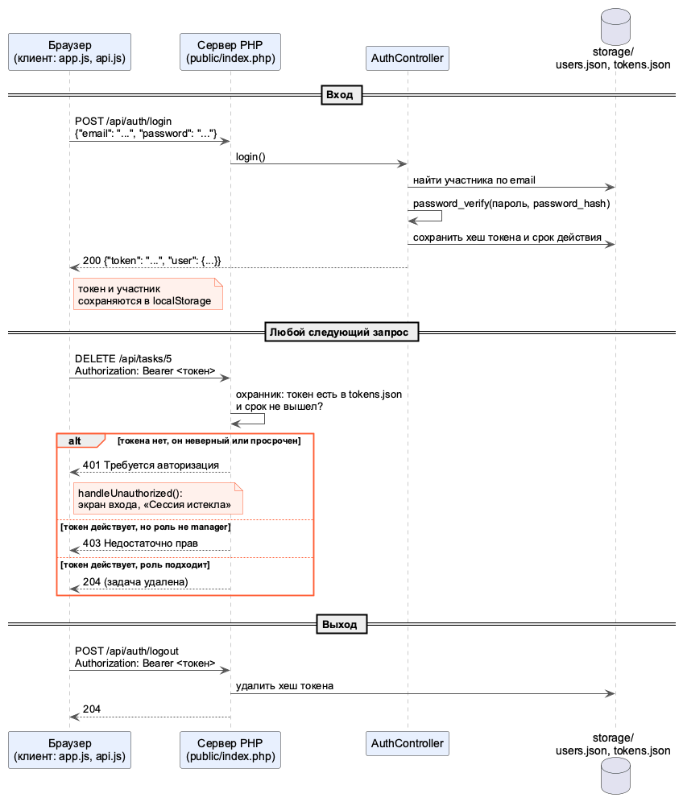
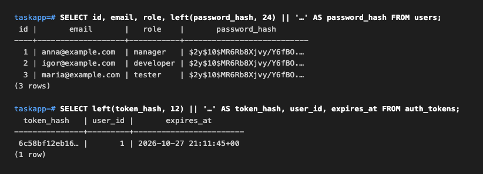
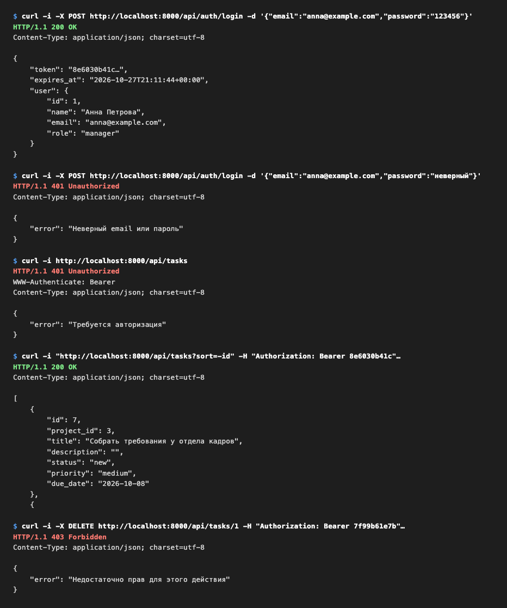
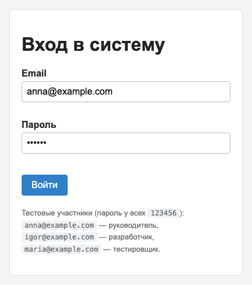
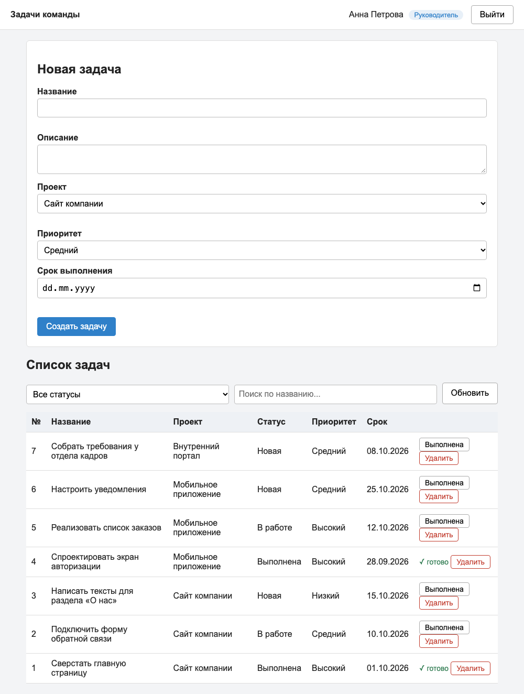
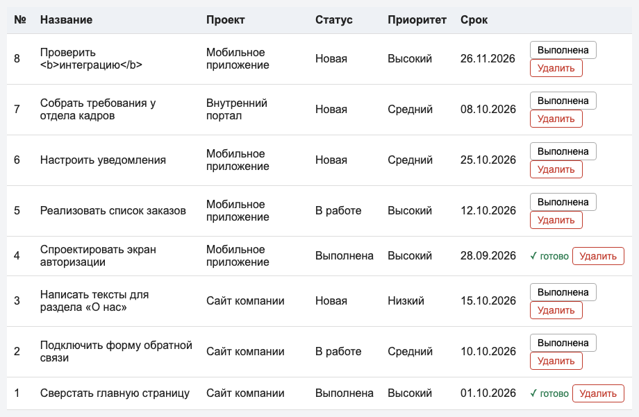
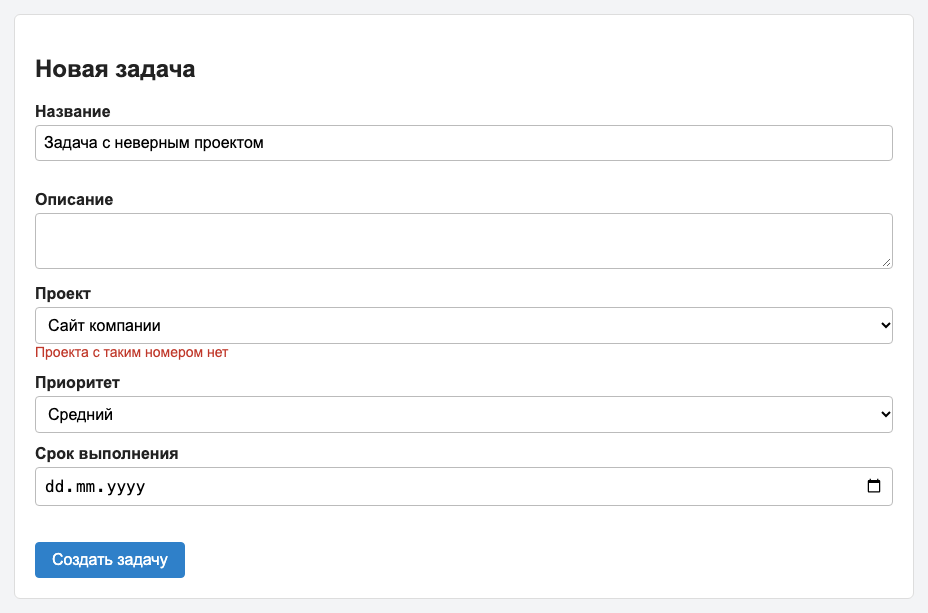
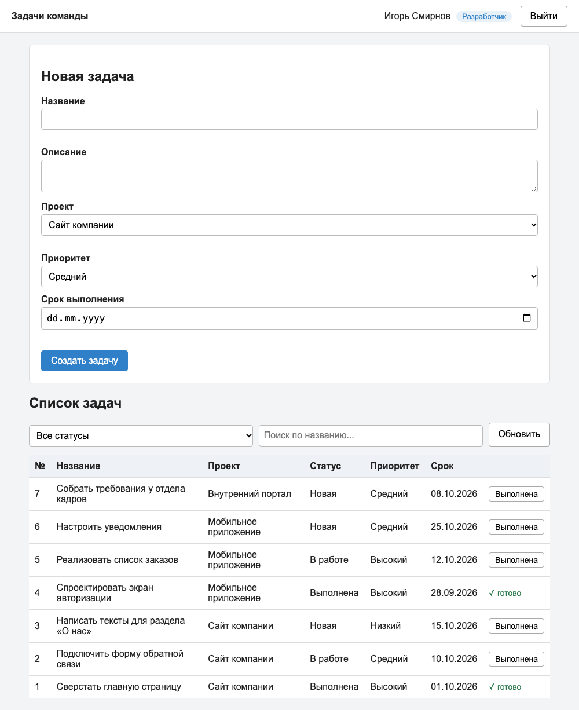
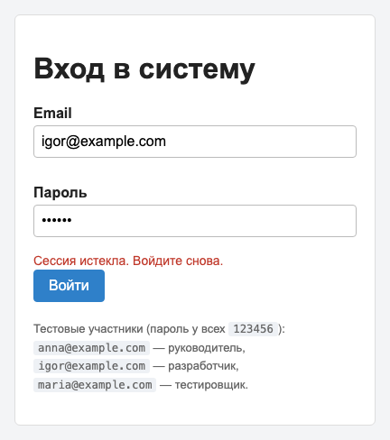
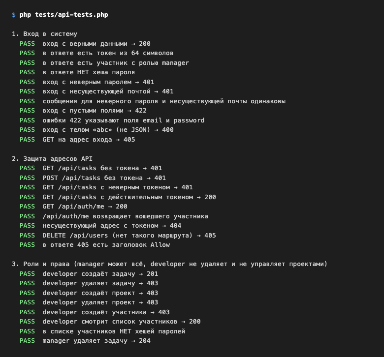

# Лабораторная работа №9
## Интеграция компонентов веб-приложения

### Цель работы

Объединить клиентскую и серверную части веб-приложения в единую систему: подключить клиент к настоящему REST API, реализовать авторизацию с разграничением прав по ролям, пройти полный пользовательский сценарий работы и выполнить комплексное тестирование.

---

## Краткое описание выполненного задания

Клиентское приложение из лабораторной работы №5 (HTML, CSS, JavaScript) подключено к серверу из лабораторной работы №7 (PHP 8.2, REST API), а данные сервера перенесены из JSON-файлов в базу данных PostgreSQL из лабораторной работы №8 (доступ через PDO). Учебный сервер `mock-api.js` отключён: на запросы клиента отвечает настоящий сервер. При первом соединении обнаружились расхождения в договорённостях между клиентом и сервером (имена полей, формат ошибок, обязательное поле проекта, параметры поиска и сортировки); они согласованы и описаны ниже.

На сервере реализована авторизация: вход по email и паролю, выдача токена, проверка токена на всех адресах API, три роли (руководитель, разработчик, тестировщик) и выход. Пароли и токены хранятся в базе только в виде хешей. Клиент получил экран входа, защиту от истёкшей сессии, интерфейс по роли и обработку ошибок сети, 401, 403 и 422. Работу проверяют 61 автоматический тест API и 23 сквозных сценария в браузере.

## Предметная область

Демонстрационный вариант 0: «Система управления задачами команды» (в вашей работе здесь заполненная карточка вашей предметной области и 2–3 предложения о переносе: что изменили и как проверили).

| Что определить | Значение |
|----------------|----------|
| Основная сущность | задача (`tasks`) |
| Связанная сущность | проект (`projects`) |
| Участники и роли | `users`: `manager`, `developer`, `tester` |
| Кто что может | смотреть и создавать задачи — все; удалять задачи, управлять проектами и участниками — только `manager` |
| Данные | PostgreSQL 16, база `taskapp`: таблицы `users` (с `password_hash`), `projects`, `tasks`, `auth_tokens` — часть схемы из лабораторной работы №8 |

---

**Запуск:**

```bash
cd lab9/src
docker compose up -d                       # PostgreSQL 16, база taskapp
php bin/reset-db.php                       # создать таблицы и загрузить данные (sql/schema.sql, sql/seed.sql)
php -S localhost:8000 -t public            # сервер (в одном окне терминала)
```

Откройте `http://localhost:8000/client/`. Тестовые участники (пароль у всех `123456`): `anna@example.com` — руководитель, `igor@example.com` — разработчик, `maria@example.com` — тестировщик. Вернуть данные к исходным: `php bin/reset-db.php`. Автотесты: `php tests/api-tests.php`. Консоль базы: `docker compose exec db psql -U postgres -d taskapp`.

Если порт 5432 занят (например, работает база из лабораторной работы №8), запустите базу и приложение на другом порту: `DB_PORT=5433 docker compose up -d`, `DB_PORT=5433 php -S localhost:8000 -t public` и `DB_PORT=5433 php tests/api-tests.php` (в PowerShell: `$env:DB_PORT=5433` в каждом окне терминала).

---

## Как устроена интеграция

```
Браузер: public/client/            Сервер: public/index.php
  index.html, css/                   ├── охранник: токен есть и действует? (иначе 401)
  js/config.js  адрес API            ├── Router → контроллер (Auth, Task, Project, User)
  js/api.js     все запросы  ──────► ├── require_role('manager') → 403, если роль не подходит
  js/app.js     экраны, события      └── модели (PDO, подготовленные запросы) ──► PostgreSQL
```

| Файл клиента | Назначение |
|--------------|------------|
| `js/config.js` | адрес API (`API_BASE`): пустой, если клиент и API на одном адресе |
| `js/api.js` | единственное место, где клиент обращается к серверу: токен и заголовки, проверка ответа (`checkResponse`), функции `login`, `me`, `logout`, `getProjects`, `getTasks`, `createTask`, `updateTask`, `deleteTask` |
| `js/app.js` | экраны «Вход» и «Список задач», обработчики событий, вывод таблицы, ошибки |

| Файл сервера | Назначение |
|--------------|------------|
| `public/index.php` | точка входа: CORS, «охранник» (проверка токена для всего API, кроме входа), маршрутизатор |
| `app/Core/Database.php` | подключение к PostgreSQL через PDO (параметры в `config/app.php`, их можно переопределить переменными окружения `DB_HOST`, `DB_PORT`, `DB_NAME`, `DB_USER`, `DB_PASSWORD`) |
| `app/Models/*Repository.php` | работа с таблицами: `PgRepository` (`all`, `find`, `add`, `update`, `delete`) и модели задач, проектов, участников; все значения передаются параметрами запроса |
| `app/Core/Auth.php` | выдача, проверка и отзыв токенов (таблица `auth_tokens`, в ней только хеши) |
| `app/Controllers/Api/AuthController.php` | `POST /api/auth/login`, `GET /api/auth/me`, `POST /api/auth/logout` |
| `app/helpers.php` | `bearer_token()`, `require_auth()`, `require_role()`, `public_user()` (запись участника без хеша пароля), CORS |
| `app/Controllers/Api/*ApiController.php` | ресурсы задач, проектов, участников; права проверяются через `require_role('manager')`; контроллеры не знают, где лежат данные |
| `sql/schema.sql`, `sql/seed.sql`, `bin/reset-db.php` | структура базы, тестовые данные и команда, которая возвращает базу к исходному состоянию |

## Авторизация



**Исходник:** [`diagrams/src/login-flow.puml`](./diagrams/src/login-flow.puml)

1. Клиент отправляет `POST /api/auth/login` с email и паролем. Сервер находит участника, сверяет пароль с хешем (`password_verify`) и выдаёт **токен** — случайную строку из 64 символов, срок действия 2 часа.
2. Клиент сохраняет токен и данные участника в `localStorage` и отправляет токен с каждым запросом в заголовке `Authorization: Bearer <токен>`.
3. «Охранник» в `public/index.php` проверяет токен до маршрутизатора. Нет токена, он неверный, просрочен или отозван — ответ **401**. Токен действует, но роль не подходит — ответ **403**.
4. При ответе 401 клиент возвращает пользователя к форме входа. При выходе клиент отзывает токен на сервере.

Что хранится в базе: в таблице `users` — `password_hash` (bcrypt), в таблице `auth_tokens` — SHA-256 хеш токена, номер участника и срок. Утечка базы не даёт ни пароль, ни рабочий токен.



### Роли и права

| Действие | manager | developer | tester |
|----------|:---:|:---:|:---:|
| смотреть задачи, проекты, участников | да | да | да |
| создавать и изменять задачи | да | да | да |
| удалять задачи | да | нет, 403 | нет, 403 |
| создавать, изменять, удалять проекты и участников | да | нет, 403 | нет, 403 |

Клиент не показывает разработчику кнопку «Удалить», но это только удобство: запрет действует на сервере и срабатывает при любом прямом запросе.

### Пример запросов



Токены в примерах сокращены. Полное описание API (параметры, примеры, коды): [docs/api.md](./docs/api.md).

## Что пришлось согласовать между клиентом и сервером

Клиент написан под учебный сервер, API — по правилам REST. При первом запуске выявились расхождения (перенос данных в PostgreSQL на контракт не повлиял: контроллеры и клиент не менялись, а ответы остались прежними, в том числе типы чисел и формат даты):

| Расхождение | Решение |
|-------------|---------|
| сервер требует `project_id`, в форме проекта нет | в форму добавлен список проектов, номер отправляется числом |
| `dueDate` у клиента и `due_date` у сервера | клиент использует `due_date` |
| пустая дата `""` и `null` | клиент отправляет `null` |
| ошибки: `fields` у клиента и `errors` у сервера | клиент читает `errors` и показывает сообщения под полями |
| сортировка: `_sort=id&_order=desc` и `sort=-id` | клиент отправляет `sort=-id` |
| сервер не знал параметр поиска `q` | на сервере поиск выполняет база: `title ILIKE :q` (без учёта регистра), сортировка — `ORDER BY` по списку допустимых столбцов |
| спецсимволы в тексте поиска | `encodeURIComponent` |
| 401 в середине работы, 403 для не-руководителя | единая обработка в `checkResponse`, кнопки по роли |
| клиент на другом адресе | CORS: адрес разрешается в `config/app.php` → `cors_origins` |

## Полный пользовательский сценарий

Вход руководителем → просмотр списка → поиск и фильтр → создание задачи → отметка «Выполнена» → удаление → выход → вход разработчиком (проверка ограничений прав).

#### Вход


#### Список задач руководителя


#### Созданная задача


#### Ошибка проверки данных от сервера (422) под полем


#### Интерфейс разработчика: нет кнопок «Удалить»


#### Сессия истекла: возврат ко входу


## Комплексное тестирование

Подробно — в [docs/testing.md](./docs/testing.md). Итог:

| Уровень | Проверок | Прошло |
|---------|---------:|-------:|
| Автотесты API (`php tests/api-tests.php`) | 61 | 61 |
| Сквозные сценарии в браузере | 23 | 23 |
| Проверки безопасности | 8 | 8 |



---

## Вывод

В результате работы клиентская и серверная части объединены в работающую систему. Клиент обращается к серверу только через `api.js`, а договорённости о формате данных (имена полей, формат ошибок, параметры списка, коды ответов) согласованы и описаны в `docs/api.md`. Реализована авторизация: пароли хранятся в виде хешей, вход выдаёт токен с ограниченным сроком, «охранник» защищает все адреса API, права разграничены по ролям, а клиент корректно реагирует на ответы 401, 403, 422 и на потерю связи. Главный вывод интеграции: проверки интерфейса удобны пользователю, но защита должна быть на сервере, а расхождения между компонентами проще всего находить по вкладке Network и коду ответа. Данные хранятся в PostgreSQL: работа с базой собрана в моделях, значения передаются подготовленными запросами (проверено попыткой SQL-инъекции в поиске), а недоступность базы клиент получает как понятный ответ 503. Автоматические тесты API и таблица сквозных сценариев позволяют быстро убедиться, что после любого изменения система по-прежнему работает целиком.

---

**Структура репозитория:**
```
lab9/
├── README.md
├── src/                          # клиент и сервер вместе
│   ├── docker-compose.yml        # PostgreSQL 16 (база taskapp)
│   ├── public/
│   │   ├── index.php             # точка входа сервера
│   │   └── client/               # клиентское приложение (/client/)
│   ├── app/                      # серверная часть (Core, Controllers, Models, helpers)
│   ├── config/app.php           # настройки: база данных, срок токена, CORS
│   ├── routes/web.php            # маршруты
│   ├── sql/                      # schema.sql (структура), seed.sql (данные)
│   ├── bin/reset-db.php          # вернуть базу к исходному состоянию
│   └── tests/api-tests.php       # автотесты API
├── diagrams/
│   ├── images/login-flow.png     # схема входа
│   └── src/login-flow.puml
├── images/                       # скриншоты (15 файлов)
└── docs/
    ├── api.md                    # документация API
    └── testing.md                # результаты комплексного тестирования
```
